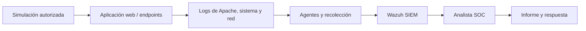

# Arquitectura BTF — interpretación inicial

## Componentes observados en el material del curso
- Red externa y estación atacante.
- Red interna con equipos Windows y Linux.
- Servidor web con Apache y servicio DNS en el diagrama.
- Servidor/servicio Wazuh SIEM y estación de investigación.
- Escenarios web mencionados en el syllabus: SQL Injection, XSS, carga de archivos y reverse shell.

> **Importante:** los dibujos del syllabus y de la plataforma son conceptuales. No se conocen todavía IP reales, interfaces, versiones, recursos ni la topología de red efectiva.

## Flujo de evidencia (simplificado)

## Analogía: centro comercial
- Sistemas: tiendas que generan eventos.
- Logs: cámaras y registros de acceso.
- Wazuh: central de seguridad que reúne señales.
- Analista: persona que valida las alertas y reconstruye hechos.
- Playbook: protocolo de actuación ante una incidencia.

## Información pendiente para el montaje
- Hipervisor o Docker y capacidad del equipo.
- Sistemas operativos y versiones.
- Segmentación y aislamiento de red.
- Ubicación del SIEM y fuentes de telemetría.
- Estrategia de snapshots, restauración y anonimización.

Nunca conectar máquinas vulnerables deliberadamente a redes públicas.
