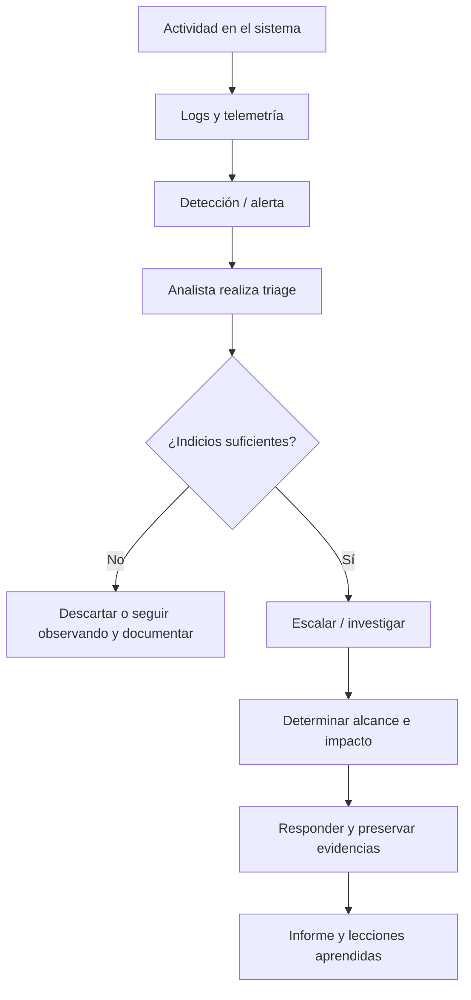

# Clase 00 — Presentación y mapa de Blue Team Fundamentals (BTF)

> **Tipo de nota:** resumen de la introducción del instructor y del documento `BTF Module 1.pdf`. No es todavía la clase técnica de *Introduction to Cyber Defense*.

## 1. ¿Cuál es el objetivo de esta introducción?

El instructor presenta la **tabla de contenidos** y explica la progresión del curso. Su idea central: comenzar por la defensa y los equipos de ciberseguridad, pasar a operaciones SOC, estudiar inteligencia y búsqueda de amenazas, conocer respuesta a incidentes y forense digital y culminar investigando escenarios prácticos.

El documento de CWL presenta BTF como entrenamiento para desarrollar habilidades de **investigación** de alertas, registros, anomalías de red y evidencias digitales.

**Diferencia importante:** esta lección todavía no enseña los procedimientos técnicos de esos temas: únicamente anuncia lo que viene.

## 2. Ruta descrita en el video

| Bloque | Lo que el instructor anuncia | Resultado que debemos perseguir al estudiarlo |
|---|---|---|
| 1. Cyber Defense | Introducción e importancia de la defensa; Red/Blue/Purple Team; jerarquía y responsabilidades; NIST | Distinguir qué defiende cada rol y por qué |
| 2. Cyber Operations | Funcionamiento de operaciones de seguridad; SOC dedicado frente a virtual; herramientas como firewalls, IDS/IPS, SIEM y SOAR; investigación inicial | Comprender el recorrido de una alerta desde que se genera |
| 3–4. Threat Intelligence & Hunting | Panorama de amenazas, Pyramid of Pain, MITRE ATT&CK y Cyber Kill Chain | Pasar de un indicador aislado a hipótesis investigables |
| 5–6. Incident Response & Forensics | Componentes y funcionamiento de IR, principios de forense y recolección de evidencia | Reconstruir un incidente sin perder trazabilidad |
| 7. Lab Exercises | Montaje del laboratorio, investigaciones web y de red, memory forensics | Documentar un caso técnico reproducible |

**Nota sobre organización:** las diapositivas PDF enumeran **siete secciones** (I–VII), mientras que la presentación de la plataforma agrupa el material de otro modo. Conservamos los títulos y el orden del PDF y tratamos los anuncios del video como vista general, no como lecciones completadas.

## 3. Analogía — De la teoría policial a una investigación SOC

Imagina una ciudad:
- **Cyber Defense:** entender cómo proteger la ciudad y quién responde por cada sector.
- **SOC:** central de vigilancia que recibe señales desde diversos edificios.
- **Threat Intelligence:** información sobre actores, patrones de delito y señales conocidas.
- **Threat Hunting:** investigadores que buscan indicios aunque aún no haya saltado ninguna alarma.
- **Incident Response:** procedimiento coordinado cuando se confirma un incidente.
- **Digital Forensics:** preservación y reconstrucción de los hechos a partir de evidencia.
- **Laboratorio:** caso simulado donde se unen todas las piezas.

**Límite de la analogía:** una alerta SIEM no equivale automáticamente a un ataque confirmado; debe investigarse y contrastarse con evidencias.

## 4. El viaje de una alerta — explicación adicional, NO transcripción

Esta secuencia es una **ampliación didáctica** para comprender cómo se conectan los módulos, no un proceso específico enseñado en las capturas.

## 5. Lo que el PDF añade

La presentación de CWL menciona que su entrenamiento se centra en:
- Investigar amenazas y actividades sospechosas.
- Monitorizar alertas, analizar logs y examinar anomalías en endpoints y redes.
- Explorar forense digital y memoria.
- Practicar en una infraestructura empresarial simulada, con guía para despliegue local.

En la diapositiva **Prerequisite (p. 10)** se mencionan conocimientos de networking, nociones de SIEM y familiaridad con línea de comandos. **Ojo:** la página de la plataforma compartida anteriormente señala que no se exige experiencia previa en Blue Team; ambas afirmaciones pueden entenderse como niveles distintos de preparación sugerida, sin asumir equivalencia exacta.

## 6. Glosario inicial (explicación complementaria)

| Sigla | Significado | Idea básica |
|---|---|---|
| SOC | Security Operations Center | Función/equipo que monitoriza e investiga eventos |
| SIEM | Security Information and Event Management | Centraliza y permite correlacionar registros de seguridad |
| IDS | Intrusion Detection System | Busca señales de intrusión y alerta |
| IPS | Intrusion Prevention System | Puede actuar para bloquear actividad conforme a sus reglas |
| SOAR | Security Orchestration, Automation and Response | Orquesta acciones e integra flujos de respuesta |
| CTI | Cyber Threat Intelligence | Información analizada útil para decisiones defensivas |
| IOC | Indicator of Compromise | Evidencia observable asociada a compromiso potencial |
| IOA | Indicator of Attack | Señal de comportamiento compatible con una técnica de ataque |
| IR | Incident Response | Respuesta organizada ante incidentes |

El instructor menciona herramientas/categorías; las definiciones anteriores son aportaciones adicionales de estudio.

## 7. Preguntas de comprobación

1. ¿Por qué una organización necesita **roles y responsabilidades**, además de herramientas?
2. ¿Qué diferencia hay entre una **alerta** y un **incidente confirmado**?
3. ¿Cómo se relacionan CTI y Threat Hunting?
4. ¿Por qué la recolección de evidencia debe ir acompañada de documentación?
5. ¿Qué aporta un laboratorio controlado que no se aprende memorizando nombres de herramientas?

## 8. Microejercicio (sin máquinas ni ataques)

**Escenario ficticio:** un servidor web registra 120 respuestas HTTP 401 en tres minutos. Un monitor genera una alerta.

- **Hecho observado:** 120 respuestas 401 en un intervalo.
- **Hipótesis 1:** intentos automatizados de autenticación.
- **Hipótesis 2:** aplicación legítima con credenciales vencidas o un cliente mal configurado.
- **Qué pedir antes de concluir:** origen(es), rutas solicitadas, user agents, cuentas afectadas, actividad posterior y registros de autenticación.
- **Conclusión correcta por ahora:** actividad anómala a investigar, **no** compromiso probado.

## 9. Bitácora de avance

- [x] Material introductorio recibido y resumido.
- [ ] Lección técnica: Introduction to Cyber Defense.
- [ ] Lección técnica: Importance of Cyber Defense.
- [ ] Roles, NIST y Red/Blue/Purple con ejemplos.
- [ ] Laboratorios y evidencias propias.

## Fuentes usadas

- **CWL:** `BTF Module 1.pdf`, pp. 3–10, aportado para estudio.
- **Transcripción visual compartida:** capturas del video introductorio sobre los módulos 1 a 7.
- **Aporte propio del repositorio:** analogía, diagrama, glosario y microejercicio.

> No se han reproducido íntegramente las diapositivas, el PDF o material de entrenamiento de terceros.
