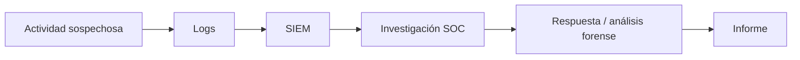

# BTF — Introducción al curso

Estas son mis notas de la presentación de **Blue Team Fundamentals (BTF)**, de CyberWarFare Labs. Por ahora, el instructor está explicando qué se verá durante el curso y cómo se relacionan los temas. Todavía no hemos entrado a las clases técnicas.

## ¿De qué trata BTF?

El curso está orientado a aprender cómo se investigan incidentes de seguridad desde el lado defensivo (Blue Team). No se trata únicamente de ver alertas en una herramienta: la idea es revisar registros, reconocer actividades sospechosas y encontrar evidencia que permita entender qué ocurrió.

En la presentación se habla de seis módulos principales y de una parte práctica. El PDF, en cambio, organiza el contenido en siete secciones, contando los laboratorios como la última. Para mis apuntes voy a seguir el orden del PDF.

## Lo que veremos en el curso

### 1. Cyber Defense

Primero se explicará qué es la ciberdefensa, por qué es importante y cómo trabajan los equipos Red, Blue y Purple Team. También se hablará de los roles y responsabilidades dentro de un equipo defensivo. Al final se menciona el framework NIST.

Lo que quiero entender aquí es **quién se encarga de qué** cuando una organización necesita prevenir, detectar o responder a un ataque.

### 2. Cyber Operations

Después entraremos al funcionamiento de un SOC (*Security Operations Center*), incluyendo la diferencia entre un SOC dedicado y uno virtual.

El instructor menciona herramientas como firewalls, IDS/IPS, SIEM y SOAR. También se verán la gestión de incidentes y los primeros pasos para investigar una alerta.

Una duda para tener presente: **¿qué hace un analista cuando le llega una alerta y cómo decide si realmente es importante?**

### 3. Threat Intelligence

En esta parte veremos inteligencia de amenazas: de dónde sale la información sobre ataques, cómo se utiliza y qué diferencia existe entre IOC (*Indicators of Compromise*) e IOA (*Indicators of Attack*).

También se menciona la *Pyramid of Pain*. La idea será entender por qué algunos indicadores son más útiles que otros para detectar o dificultar la actividad de un atacante.

### 4. Threat Hunting

Aquí el enfoque cambia un poco. En lugar de esperar una alerta, se busca actividad sospechosa de forma proactiva.

El contenido anunciado incluye MITRE ATT&CK y Cyber Kill Chain. Me interesa entender cómo pasar de una sospecha a una búsqueda concreta en los logs.

### 5. Incident Response

Se estudiará cómo se organiza la respuesta a incidentes y cuáles son sus componentes y etapas.

No basta con detectar actividad maliciosa: también hay que saber qué investigar, qué escalar, cómo contener el problema y qué dejar documentado.

### 6. Digital Forensics

El instructor anuncia análisis forense digital, recolección de evidencia e investigaciones posteriores a un compromiso.

También habrá una práctica de **memory forensics**, es decir, análisis de información obtenida de la memoria de un equipo.

### 7. Laboratorios

Esta es la parte que más quiero aprovechar. Según la presentación se trabajará con un entorno empresarial simulado y con investigaciones de ataques web, tráfico de red y memoria.

El instructor también menciona **cinco desafíos de investigación** basados en escenarios reales o inspirados en ellos. Eso no significa que ya estén resueltos: iremos documentándolos cuando lleguemos a cada uno.

## Algo que me llamó la atención: los logs

En las capturas, el instructor insiste bastante en que durante BTF se analizarán **security logs** para identificar anomalías y posibles actividades maliciosas.

Esto es importante porque un log, por sí solo, puede ser bastante ambiguo. Por ejemplo:

> Un servidor registra 120 respuestas HTTP 401 en tres minutos.

Eso podría ser un intento de acceso automatizado, pero también una aplicación con credenciales equivocadas. Tendría que revisar de dónde vienen las solicitudes, qué rutas se consultaron y si hubo algún acceso exitoso después.

La idea es no confundir **algo raro** con **un ataque confirmado**.

## ¿Y el análisis de memoria para qué sirve?

El instructor menciona que se investigarán incidentes posteriores al compromiso y que habrá un análisis de memoria.

Un ejemplo sencillo para entenderlo: los logs permiten revisar lo que un equipo fue registrando; un volcado de memoria puede conservar información del estado del sistema en un momento determinado, como procesos y otros artefactos, dependiendo de cómo se adquirió.

Son fuentes distintas de evidencia. Lo interesante será aprender a relacionarlas, no depender de una sola.

## Cómo conecto todo esto

Para entender el recorrido completo, me sirve pensar en un caso inventado:

1. En una aplicación web aparece actividad sospechosa.
2. Los logs del servidor guardan detalles de las solicitudes.
3. El SIEM recibe esos eventos y puede generar una alerta.
4. El analista SOC revisa qué pasó y si hay indicios reales de ataque.
5. Si se confirma un incidente, se activa la respuesta correspondiente.
6. Si hace falta profundizar, pueden revisarse otras evidencias, como tráfico de red o memoria.
7. Finalmente, se documenta lo que se encontró y las medidas tomadas.

**Ojo:** este ejemplo es mío para unir los temas; no es una práctica realizada ni una transcripción del profesor.

## Qué necesito manejar antes de los laboratorios

El PDF menciona como conocimientos previos:

- Redes: IP, puertos, protocolos y conexiones.
- Una idea básica de qué hace un SIEM.
- Comandos básicos en terminal.

Esto aparece en la página 10 de la presentación. No se exige en ese PDF dominar de antemano el trabajo de Blue Team, pero sí conviene tener estas bases.

## Cosas para repasar

- ¿Cuál es la diferencia entre un evento, una alerta y un incidente?
- ¿En qué se diferencia un SOC de un SIEM?
- ¿Cuándo conviene investigar una alerta antes de escalarla?
- ¿Qué diferencia hay entre investigar logs y revisar memoria?
- ¿Qué información necesitaría para afirmar que una actividad fue maliciosa?

## Mi progreso

- [x] Revisé el temario y la introducción del instructor.
- [ ] Introduction to Cyber Defense.
- [ ] Importance of Cyber Defense.
- [ ] Red, Blue y Purple Team.
- [ ] Roles y responsabilidades.
- [ ] NIST.

---

**Material de referencia:** video introductorio compartido en capturas y presentación *BTF Module 1.pdf* de CyberWarFare Labs (especialmente páginas 3–10).

**Nota:** las explicaciones y el caso HTTP 401 se añadieron para estudiar mejor. Los temas anunciados por el instructor no deben confundirse con prácticas ya realizadas.
