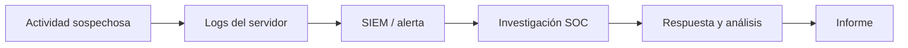

# BTF — Introducción a Cyber Defense

Apuntes de la clase *Introduction to Cyber Defence*, a partir de las capturas del video y del PDF de CyberWarFare Labs (págs. 3–7 y 24–31). Aunque el archivo recibido se llama «Module 2», su portada indica «Module 01».

## 1. ¿Qué explica el instructor?

Una empresa puede trabajar con servidores, computadoras de empleados, Active Directory, aplicaciones web y servicios cloud. Todos estos elementos hacen que funcione el negocio, pero también introducen configuraciones y posibles vulnerabilidades.

El punto de la clase es que **la seguridad empresarial no es algo que se configure una sola vez**. Conforme cambian las tecnologías y aparecen nuevas amenazas, también tienen que cambiar los controles de seguridad.

### Ejemplo: empresa que migra a la nube

Al principio, una empresa tiene servidores y aplicaciones dentro de sus oficinas. Sus controles incluyen permisos, firewalls, monitoreo y actualizaciones. Luego migra algunos servicios a la nube.

La migración puede facilitar el trabajo remoto, pero ahora tiene que prestar atención a nuevos detalles: permisos en la nube, almacenamiento expuesto, identidades, claves de acceso y registros de actividad.

No significa que la nube sea insegura. **El riesgo aparece cuando se utiliza una tecnología sin configurar adecuadamente su seguridad.**

## 2. Threat Landscape (panorama de amenazas)

Es el conjunto de amenazas, actores, técnicas y condiciones de exposición que afectan a una organización. Cambia según la tecnología utilizada y el tipo de empresa.

**Ejemplo:** una empresa configura por error un almacenamiento cloud para que cualquiera pueda acceder a él.

- **Activo:** el almacenamiento.
- **Debilidad:** permisos públicos que no deberían estar habilitados.
- **Amenaza:** acceso de una persona no autorizada.
- **Riesgo:** posible exposición de información interna.
- **Control:** revisar permisos, restringir accesos y monitorizar los cambios.

Importante: encontrar un recurso expuesto **no demuestra por sí mismo** que alguien haya descargado los archivos. Eso requiere investigación.

## 3. Áreas de la seguridad empresarial

La diapositiva 7 menciona estas áreas:

| Área | Qué protege | Ejemplo |
|---|---|---|
| Access Control | Acceso a sistemas y datos | MFA, permisos, roles |
| Network Security | Redes y comunicaciones | Firewalls, segmentación |
| Endpoint Security | Computadoras y servidores | Antivirus, EDR |
| Data Security | Información | Cifrado y respaldos |
| Physical Security | Instalaciones y equipos | Controles de acceso físico |
| Application Security | Aplicaciones | Validación de entradas, pruebas de seguridad |
| Vulnerability Management | Debilidades conocidas | Evaluación y corrección |

Todas importan. Un firewall correctamente configurado no compensa una cuenta comprometida con permisos excesivos.

## 4. Defensa proactiva y reactiva

El PDF presenta dos enfoques:

**Proactiva:** intentar evitar que un ataque tenga éxito. Por ejemplo, corregir una configuración insegura, actualizar servidores y controlar los accesos.

**Reactiva:** investigar y actuar cuando se detecta una amenaza o incidente. Por ejemplo, revisar una alerta de accesos no autorizados, determinar su alcance y contener el problema.

Si administramos un servidor Linux con SSH:

- **Antes:** restringimos accesos, configuramos autenticación segura y monitoreo (proactivo).
- **Después de una alerta:** revisamos intentos de inicio de sesión, procesos y cambios realizados (reactivo).

Los enfoques se complementan. Aunque las diapositivas agrupan Threat Hunting y Threat Intelligence como reactivos, ambas actividades también pueden utilizarse de manera proactiva.

## 5. Tríada CIA

La diapositiva 6 presenta tres objetivos de seguridad:

- **Confidencialidad (Confidentiality):** impedir que personas no autorizadas accedan a información. Ejemplo: proteger los datos de clientes.
- **Integridad (Integrity):** evitar alteraciones no autorizadas. Ejemplo: impedir la modificación indebida de un saldo.
- **Disponibilidad (Availability):** permitir que los servicios y datos estén accesibles cuando se necesitan. Ejemplo: mantener operativa una aplicación.

Un mismo incidente puede afectar varios principios al mismo tiempo.

## 6. Relación con NIST

El material enseña cinco funciones del NIST Cybersecurity Framework:

1. **Identify:** conocer activos, procesos y riesgos.
2. **Protect:** implementar protecciones.
3. **Detect:** descubrir eventos sospechosos mediante monitoreo y registros.
4. **Respond:** investigar, contener y reducir el impacto de incidentes.
5. **Recover:** restaurar operaciones y aprender de lo ocurrido.

**Dato adicional actualizado, no incluido en esas diapositivas:** NIST CSF 2.0 (2024) incorpora **Govern**, centrado en cómo la organización define y supervisa su estrategia de gestión del riesgo. Estas funciones no tienen que ejecutarse como pasos estrictamente consecutivos.

## 7. Caso para conectar los temas

Supongamos que un servidor web muestra actividad extraña:

Imaginemos que aparecen **120 respuestas HTTP 401 en tres minutos**. Podrían indicar intentos automatizados de autenticación o simplemente un cliente mal configurado. Antes de sacar conclusiones habría que revisar IPs, cuentas afectadas, rutas solicitadas, horarios y eventos posteriores.

La diferencia es importante: **una alerta no equivale a un compromiso confirmado**.

## 8. Preguntas para repasar

1. ¿Por qué una empresa debe revisar sus controles cuando adopta tecnologías nuevas?
2. ¿Qué diferencia hay entre una vulnerabilidad, un riesgo y un incidente?
3. ¿Qué harías de forma proactiva y reactiva ante un almacenamiento cloud expuesto?
4. ¿Cuál de los principios CIA se ve afectado si alguien modifica datos sin permiso?
5. ¿En qué se diferencia un SOC de un SIEM?

## Pendiente de estudiar

El mismo PDF incluye después la importancia de la defensa, ejemplos de incidentes, Red/Blue/Purple Team, jerarquía de roles y más detalle sobre NIST. Esos temas se trabajarán por separado.

---

**Fuente del curso:** *Blue Team Fundamentals — Introduction to Cyber Defence*, CyberWarFare Labs, PDF proporcionado y capturas de la lección. Los ejemplos de almacenamiento cloud, Linux SSH y HTTP 401 son explicaciones de apoyo, no prácticas realizadas.
