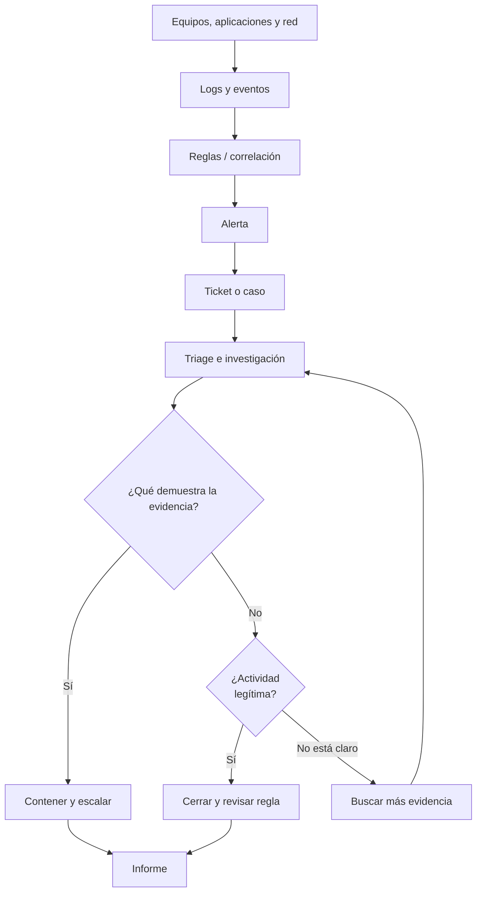

# Operaciones SOC — cómo se trabaja con las alertas

En esta parte del curso se explica cómo funciona un Security Operations Center (SOC). Su trabajo no consiste solo en mirar dashboards: tiene que recibir eventos, investigar alertas, clasificar casos y coordinar la respuesta.

El PDF habla de monitoreo continuo, investigación de alertas y trabajo con Threat Intelligence, Incident Response y Forensics (págs. 3–16). Un SOC puede operar 24/7 según las necesidades de la organización.

## Log, evento, alerta e incidente

- **Log:** registro de lo que ocurrió en un sistema. Por ejemplo, una línea de Apache con una solicitud HTTP.
- **Evento:** suceso concreto, como un inicio de sesión. Puede quedar registrado en un log.
- **Alerta:** aviso generado por una regla o mecanismo de detección.
- **Incidente:** actividad o conjunto de actividades que compromete o amenaza la seguridad y requiere gestión.

No es lo mismo tener una alerta que tener un incidente confirmado.

## Los niveles de un SOC

El instructor presenta al SOC Manager y a los analistas Tier 1, Tier 2 y Tier 3. Es una jerarquía habitual, no universal.

| Rol | Qué suele hacer |
|---|---|
| L1 | Monitorea, valida alertas, reúne contexto y escala |
| L2 | Profundiza la investigación, correlaciona evidencias y apoya la contención |
| L3 | Investiga casos complejos, mejora detecciones y asesora al equipo |
| SOC Manager | Coordina la operación, prioridades y escalamiento |

## Las fases de operación de la clase

El PDF muestra un ataque web ilustrativo, con un patrón de SQL injection que aparece en logs de Apache. Esa actividad pasa por el SIEM y luego es revisada por el equipo defensivo.

**Fase 01:** recoger registros de equipos y sistemas y evaluarlos con reglas y patrones.  
**Fase 02:** generar alertas y registrar tickets.  
**Fase 03:** investigar y decidir si la detección es correcta o falsa alarma.  
**Fase 04:** documentar, colaborar con el usuario o responsable del host, reunir evidencia y, si corresponde, pasar al equipo forense. Ante falsos positivos, revisar la regla.

### Ejemplo para entenderlo

Una alerta dice que alguien creó una tarea programada sospechosa. Revisaría la cuenta que la creó, hora, comando, archivo ejecutado, motivo del cambio y otras acciones del equipo. Si coincide con mantenimiento autorizado, puede ser un falso positivo; si hay evidencia de persistencia maliciosa, se escala.

Un buen analista no se queda con el título de la alerta.

## SOC dedicado y SOCaaS

El PDF también diferencia el SOC dedicado (equipo y operación gestionados por la organización) de *SOC as a Service* (servicio proporcionado por un tercero). Un SOC dedicado da mayor control directo, pero exige personal, infraestructura y presupuesto. SOCaaS puede facilitar cobertura, aunque hay que definir acceso a datos, coordinación, integración y responsabilidades.

## Para repasar

1. ¿Por qué no todas las alertas son incidentes?
2. ¿Qué debe entregar L1 cuando escala a L2?
3. ¿Qué información se perdería si no documentamos el caso?
4. ¿Qué ventajas y limitaciones tiene un SOC externo?

**Fuente:** BTF, *Introduction to Cyber Operations*, pp. 3–21; ejemplos adicionales escritos para estudiar.
