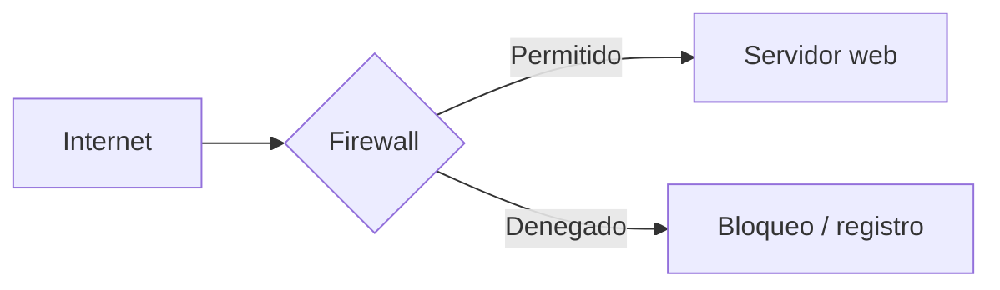
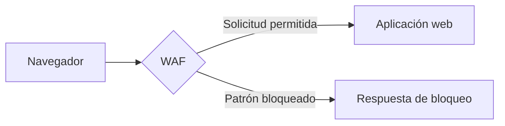

# Firewall, WAF y NGFW

El PDF presenta primero las herramientas que controlan el tráfico. Las tres se relacionan, pero no hacen exactamente lo mismo.

## Firewall tradicional

Un firewall aplica reglas para permitir o bloquear tráfico. Se pueden utilizar direcciones IP, puertos, protocolos y, en algunos productos, información de aplicación.

Ejemplo: una empresa permite conexiones HTTPS al servidor web, pero restringe SSH para que solo puedan conectarse administradores desde una red autorizada.

### Stateless vs Stateful

| | Stateless | Stateful |
|---|---|---|
| Qué evalúa | Paquetes según reglas sin mantener el estado de la sesión | Paquetes y estado de las conexiones |
| Contexto | Limitado al paquete y regla | Puede reconocer conexiones establecidas |
| Ejemplo | Permitir o negar TCP/443 según IP | Permitir paquetes de respuesta relacionados con una conexión válida |

La diapositiva considera al stateful generalmente más seguro. Eso no reemplaza una política correcta: un firewall mal configurado, sea cual sea su tipo, puede dejar expuesto un servicio.

## WAF — Web Application Firewall

Un WAF analiza tráfico HTTP/HTTPS hacia una aplicación web y puede aplicar reglas para detectar o bloquear ataques web.

Sirve para reducir exposición a patrones de SQL injection, XSS y otros ataques, según la configuración. **No sustituye corregir el código vulnerable.** En esta parte se parece a un reverse proxy, ya que puede situarse delante de la aplicación.

## NGFW — Next-Generation Firewall

La clase presenta al NGFW como una evolución del firewall, con inspección más avanzada, prevención de intrusiones, controles por aplicación e integración con inteligencia de amenazas. Se menciona especialmente DPI (*Deep Packet Inspection*).

Un NGFW reúne varias capacidades, pero que un fabricante las anuncie no significa que todas estén activas ni bien configuradas.

## En qué se diferencian

- **Firewall:** controla tráfico según políticas de red y, dependiendo del equipo, también de aplicación.
- **WAF:** está orientado a proteger aplicaciones web y analizar solicitudes HTTP.
- **NGFW:** combina funciones tradicionales con inspección y detección más avanzadas.

**Analogía breve:** un firewall sería el control de ingreso de un edificio; el WAF revisaría las solicitudes que llegan a una oficina concreta; el NGFW agregaría más información para decidir a quién permitir el paso. Esta analogía no sustituye revisar qué tráfico inspecciona realmente cada producto.

**Fuente:** BTF, pp. 23–32. Diagramas y ejemplos propios.
