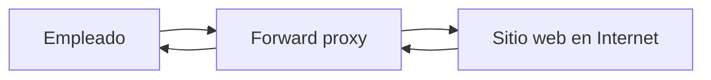
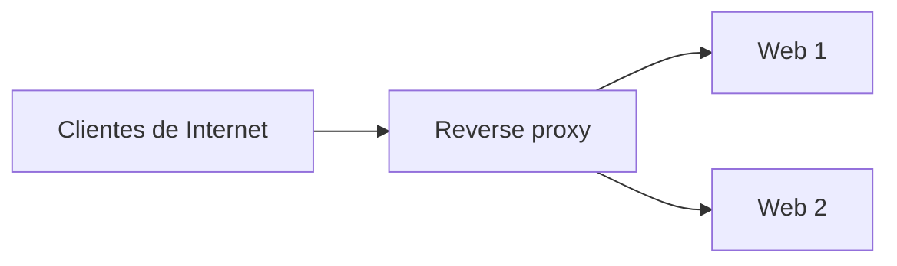
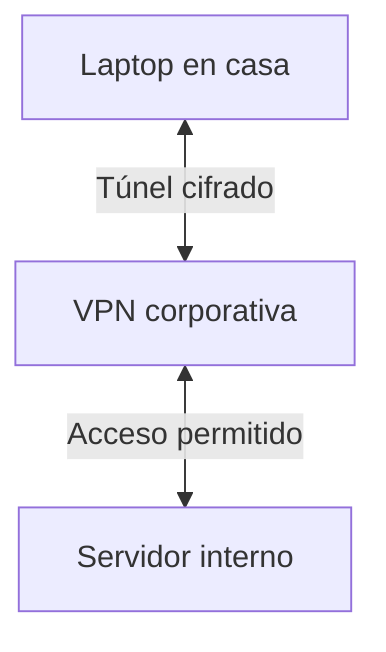

# Proxy y VPN

Estas dos tecnologías aparecen juntas en el material, aunque cumplen funciones diferentes. Conviene distinguirlas porque suelen confundirse.

## Proxy

Un proxy recibe solicitudes de un cliente y las envía a otro servidor. Según el producto, puede filtrar destinos, registrar solicitudes, almacenar respuestas en caché o balancear carga.

En el ejemplo del instructor, el empleado no hace la solicitud directamente al destino: primero pasa por el proxy de la empresa. Esto permite aplicar políticas antes de salir a Internet.

**Tipos mencionados en la clase:**

- **Forward proxy:** representa a los clientes cuando acceden a otros servidores.
- **Reverse proxy:** recibe conexiones externas en nombre de uno o varios servidores internos. Se puede usar para balancear carga.
- **SSL/TLS proxy:** puede terminar o inspeccionar conexiones cifradas cuando está configurado y autorizado para hacerlo.
- **Transparent proxy:** opera sin requerir una configuración explícita del proxy en el cliente.

El proxy **no ofrece anonimato absoluto**. Puede reducir la exposición de la IP del cliente ante el destino, pero cabeceras, cookies y otros datos aún pueden identificarlo.

### Para el SOC

Si el proxy registra URL, fecha, IP de origen, acción y estado, esos datos pueden servir para investigar navegación sospechosa. Un destino desconocido por sí solo no demuestra un ataque.

## VPN

La VPN crea un túnel protegido sobre una red no confiable. El ejemplo del video es un empleado trabajando desde casa que necesita acceder a recursos de la empresa.

Primero se autentica el usuario; después se establece el túnel y se encaminan las comunicaciones permitidas. La VPN no abre automáticamente todos los servidores internos: las rutas y los permisos siguen contando.

El cifrado protege el tráfico **del túnel**; no hay que asumir que el segmento interno posterior también está cifrado si el servicio no usa, por ejemplo, TLS.

### Diferencia esencial

| | Proxy | VPN |
|---|---|---|
| Función | Intermediar solicitudes | Proteger un túnel de comunicación |
| Alcance | Puede ser por aplicación o protocolo | Puede transportar tráfico de red conforme a rutas y políticas |
| Cifrado | Depende de la configuración | Es parte de los protocolos VPN seguros |
| Uso típico del video | Controlar navegación y ocultar la IP interna ante ciertos destinos | Conectar a un empleado remoto con recursos corporativos |

También existen VPN site-to-site entre sedes.

**Analogía:** el proxy es una recepción que envía solicitudes por ti; la VPN es un canal protegido entre dos puntos. Ambos pueden utilizarse juntos.

**Fuente:** BTF, pp. 33–38 y capturas de la explicación del instructor. Diagramas propios.
