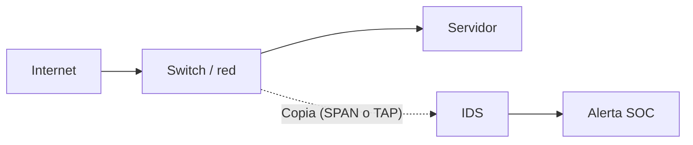
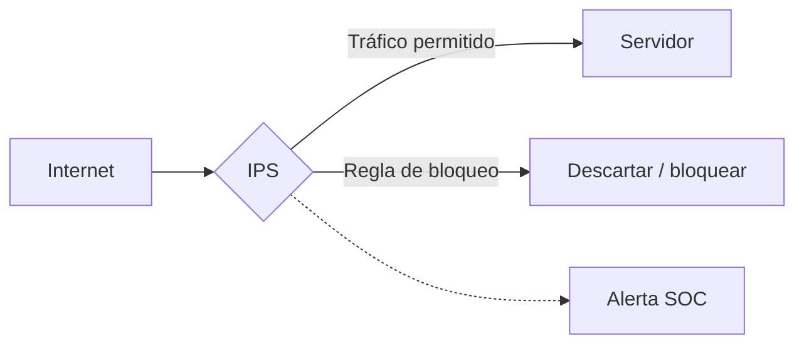

# IDS e IPS

En esta clase el instructor explica cómo detectar tráfico sospechoso y cuándo es posible bloquearlo.

**IDS (Intrusion Detection System):** inspecciona actividad de red o de sistemas y genera detecciones.  
**IPS (Intrusion Prevention System):** además de detectar, puede intervenir para bloquear tráfico según sus reglas.

## Lo que muestra el diagrama

La imagen del curso representa comunicaciones externas que pasan por monitoreo de intrusiones web y de red antes de llegar a servidores. El flujo de permitir o bloquear depende de la función de prevención.

### IDS observando una copia del tráfico

### IPS en línea

La diferencia se nota: un IDS pasivo observa, mientras que un IPS en línea puede impedir que parte del tráfico siga su camino. Un IPS también podría operar temporalmente en modo solo detección.

## ¿Cómo detectan?

- **Firmas:** coincidencias con patrones conocidos.
- **Anomalías:** comportamientos que se apartan de lo esperado.
- **Análisis de protocolos:** identificación de actividades que incumplen ciertas reglas o presentan indicios sospechosos.

**Ejemplo:** una solicitud hacia Apache coincide con una firma de explotación. El IDS puede alertar; un IPS correctamente configurado podría bloquearla. Nada de esto garantiza que el ataque haya funcionado ni que el equipo esté comprometido.

## IDS, IPS y firewall

| Herramienta | Enfoque |
|---|---|
| Firewall | Controlar comunicaciones conforme a políticas |
| IDS | Detectar e informar actividad sospechosa |
| IPS | Detectar y bloquear actividad definida como maliciosa |

Un NGFW puede reunir varias de estas capacidades.

### Algo fácil de pasar por alto

Si el tráfico HTTPS está cifrado y el sensor no dispone de una forma autorizada de observar el contenido, su análisis será limitado. Tampoco conviene configurar bloqueos muy agresivos sin probarlos: un falso positivo en IPS puede interrumpir comunicaciones legítimas.

**Fuente:** BTF, pp. 39–41 y capturas del video. Diagramas propios.
