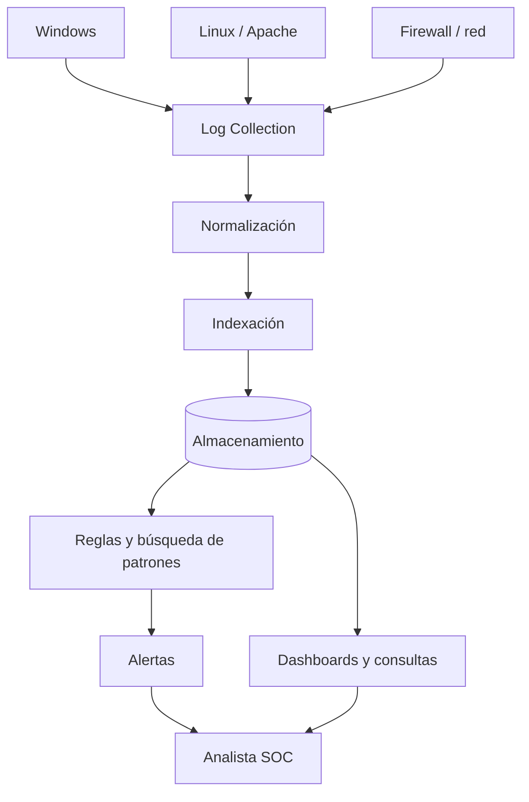

# SIEM — arquitectura y flujo de logs

El SIEM (Security Information and Event Management) centraliza información de distintas fuentes y ayuda a investigar eventos de seguridad. La idea de la clase es entender lo que ocurre **antes** de que veamos una alerta en el dashboard.

En una empresa hay logs de Windows, Linux, Apache, firewalls y dispositivos de red. Cada uno registra cosas distintas, a veces con formatos diferentes.

## Arquitectura

El instructor enumera fuentes de datos, normalización, indexación, almacenamiento, detección de anomalías y visualización. En la diapositiva se lee «Virtualization», pero el diagrama corresponde a **Visualization**.

## Fase 01: preparar los registros

**Log collection:** recopilar logs mediante agentes, syslog, integraciones u otros mecanismos.

**Normalization:** extraer y organizar campos para poder buscar datos consistentes. Por ejemplo:

| Log original | Campo normalizado de ejemplo |
|---|---|
| Usuario `admin` | `user.name` |
| IP `192.0.2.45` | `source.ip` |
| Resultado `Failed password` | `event.outcome: failure` |

Los campos son ilustrativos; cada solución usa su esquema y transformaciones.

**Indexing:** preparar estructuras para localizar registros por fecha, IP, equipo u otros campos.

**Storage:** conservar los datos según la política de retención. La integridad, permisos y tiempos de conservación importan para investigar incidentes antiguos.

## Fase 02: detección y visualización

Las **reglas** buscan condiciones que merezcan atención. Por ejemplo, más de 10 fallos SSH desde un origen en 2 minutos podrían originar una alerta. Es una lógica de ejemplo, no una regla de Wazuh lista para instalar.

El **pattern matching** busca coincidencias con firmas o secuencias definidas. Los dashboards ayudan a ver tendencias, pero el gráfico solo es una forma de visualizar los registros.

## Ejemplo para acordarme

Un SIEM se parece a una biblioteca de registros: los equipos entregan documentos, se clasifican, se indexan, se guardan y luego podemos buscar un tema concreto. La comparación sirve para entender el flujo, aunque el SIEM también ejecuta lógica de detección.

## Lo más importante

Si un agente deja de enviar logs o una normalización asigna mal los campos, el SIEM puede perder visibilidad aunque el dashboard siga funcionando. Una alerta es una pista, no una sentencia.

**Fuente:** BTF, pp. 42–46 y capturas del instructor. Diagrama y ejemplos propios.
