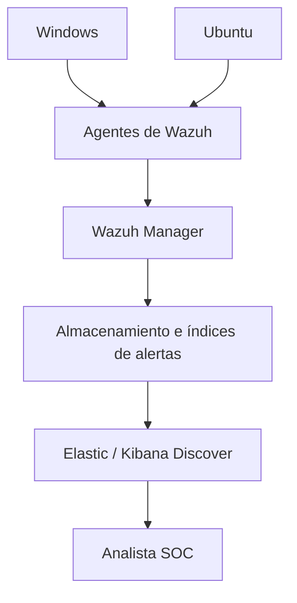

# Demostración SIEM — Wazuh con Elastic/Kibana

Estas notas vienen de las capturas del video, no de una práctica ejecutada por mí. El instructor utiliza una interfaz de Wazuh integrada con Elastic/Kibana; la arquitectura y pantallas pueden cambiar según la versión.

## Lo que se ve en pantalla

El panel indica **10 agentes totales, 10 activos y 0 desconectados**. Se mencionan máquinas Windows y Ubuntu que envían registros al manager.



Que todos estén conectados es una buena señal, pero no demuestra que cada tipo de log deseado esté recopilándose correctamente.

## Los filtros de Discover

El patrón visible es:

```text
wazuh-alerts-*
```

Permite consultar índices con nombres que comienzan por ese prefijo. Se trata de **alertas indexadas**, no necesariamente de todos los logs originales.

En la captura inicial aparecen **7,247 resultados** con el filtro `manager.name: PTSIEM` y una ventana de 24 horas. El instructor luego escribe:

```kql
data.win.system.eventID : 4624
```

La consulta deja **1,743 resultados** en esa demostración. Estos números pertenecen al video y **no son métricas de mi propio entorno**.

## ¿Qué es el 4624?

En Windows, el Event ID **4624** representa un inicio de sesión exitoso. Eso no equivale a un ataque. En el video aparecen campos como `agent.name`, `agent.ip`, `data.win.system.computer`, `data.win.eventdata.logonType`.

| LogonType | Significado habitual |
|---|---|
| 2 | Interactive, acceso local |
| 3 | Network, acceso por red |
| 4 | Batch, tarea por lotes |
| 5 | Service |
| 7 | Unlock |
| 10 | RemoteInteractive, como RDP |

El analista podría correlacionar 4624 con eventos como **4625** (inicio fallido), **4648** (uso de credenciales explícitas) y **4672** (privilegios especiales al iniciar sesión), revisando los campos que correspondan.

## Cómo investigaría un caso

Si encuentro muchos 4624, no afirmaría que hubo cientos de ataques. Filtraría equipo, usuario, IP de origen, periodo y tipo de inicio de sesión. Después buscaría qué pasó antes y después.

Otra idea de la clase: las reglas pueden asignar niveles de alerta o relacionarse con MITRE ATT&CK. Aun así, la clasificación de verdadero o falso positivo se determina con evidencia.

**Pendiente para mi laboratorio:** reproducir una consulta equivalente con mis propios agentes y guardar resultados anonimizados.

**Fuente:** capturas de la demo BTF (10 agentes, 7,247 resultados y filtro 4624). Explicación adicional para comprender el procedimiento.
