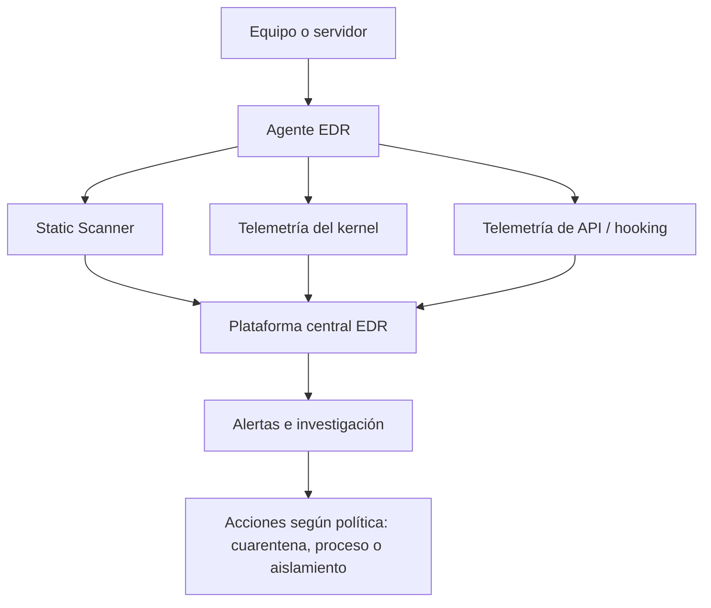

# EDR — Endpoint Detection and Response

El EDR observa lo que ocurre en los equipos: procesos, archivos, conexiones y otros eventos de seguridad. A diferencia de una herramienta que solo bloquea archivos conocidos, ayuda a investigar **qué hizo un programa y qué pasó en el host**.

Los endpoints pueden ser laptops, computadoras o servidores.

## Diagrama de la clase

La diapositiva describe un **Static Scanner**, un **Kernel-mode Driver** y **Hook DLL**. Son mecanismos de análisis y recopilación ilustrados por el instructor; no todos los productos EDR utilizan la misma arquitectura.

- El escaneo estático examina un archivo sin ejecutarlo.
- La telemetría del kernel puede aportar eventos del sistema a bajo nivel.
- Algunas soluciones observan llamadas API de procesos mediante instrumentación, pero eso depende de la implementación.

## Ejemplo

Se abre un documento y luego `WINWORD.EXE` inicia `powershell.exe`. El comportamiento merece contexto: comando exacto, usuario, árbol de procesos y conexiones. No basta con que PowerShell se ejecute para concluir que hay malware.

Si se confirma una amenaza, un EDR puede permitir terminar el proceso, poner un archivo en cuarentena o aislar la red del host según el producto y los permisos. Aislar un servidor crítico sin evaluar el impacto puede afectar producción.

## Antivirus vs EDR

| | Antivirus | EDR |
|---|---|---|
| Función típica | Detectar o bloquear amenazas | Detectar, investigar y responder |
| Visibilidad de procesos | Depende del producto | Suele ser más amplia |
| Análisis retrospectivo | Variable | Una capacidad habitual |
| Respuesta remota | Variable | Habitual |

Los antivirus modernos pueden incluir funcionalidades avanzadas. La división no es absoluta.

## Cómo se conecta con el resto

El EDR investiga el **host**, el IDS/IPS observa o filtra determinadas actividades, y el SIEM permite correlacionar eventos de distintas fuentes. SOAR puede coordinar acciones, si está integrado.

**Fuente:** BTF, pp. 48–50 y capturas del instructor. Diagrama simplificado propio.
