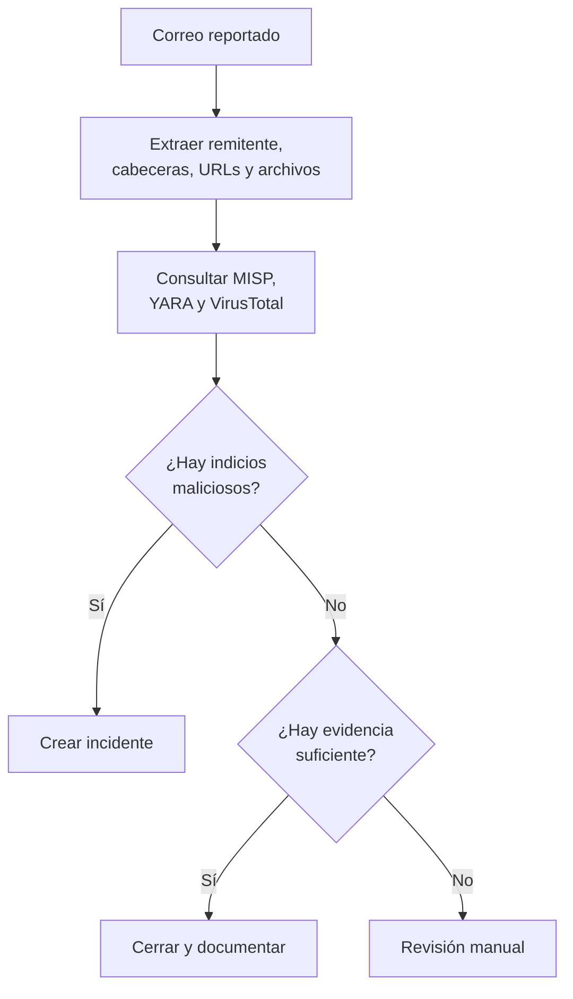

# SOAR — orquestación, automatización y respuesta

SOAR significa *Security Orchestration, Automation and Response*. Se utiliza para coordinar herramientas y ejecutar tareas repetitivas siguiendo un flujo o **playbook**.

Antes veíamos alertas aisladas. La idea de SOAR es que una investigación no dependa de consultar manualmente cinco herramientas para hacer siempre las mismas comprobaciones.

## Tres palabras distintas

- **Orquestar:** conectar herramientas, por ejemplo MISP, VirusTotal y un sistema de tickets.
- **Automatizar:** extraer indicadores de un correo y consultarlos sin repetir los pasos manualmente.
- **Responder:** abrir un incidente o proponer una medida según los resultados y la política.

Analogía: en una cocina, el encargado coordina las estaciones y algunas tareas están mecanizadas; pero alguien sigue tomando decisiones cuando la situación no coincide con la receta. En seguridad, el playbook es la receta.

## El ejemplo del video: correo reportado

El flujo de arriba **resume** las consultas en un solo bloque para que el gráfico se lea completo. En la práctica, cada comprobación puede ejecutarse por separado o en paralelo.

El diagrama original simplifica los resultados como **Clean** o **Malicious**. En la práctica conviene contemplar **Inconclusive**: un indicador sin detecciones en VirusTotal no se vuelve automáticamente confiable.

### Herramientas del flujo

| Herramienta | Para qué se menciona |
|---|---|
| MISP | Consultar y compartir inteligencia de amenazas |
| YARA | Buscar patrones definidos en contenido o archivos |
| VirusTotal | Consultar resultados de análisis de hashes, archivos o URLs |
| Análisis de cabeceras | Revisar información técnica del correo |

Subir archivos o correos sensibles a servicios públicos requiere revisar las políticas de privacidad y seguridad. Tampoco conviene automatizar bloqueos de alto impacto sin condiciones y controles adecuados.

## Relación con SIEM y gestión de incidentes

Un SIEM genera o presenta alertas; SOAR ejecuta un flujo; un gestor de casos como TheHive permite asignar tareas y documentar decisiones. Las funciones se pueden solapar según el producto.

**Fuente:** BTF, pp. 51–53 y capturas de la explicación del instructor. Diagrama ampliado con la rama «inconcluso» para estudiar mejor.
