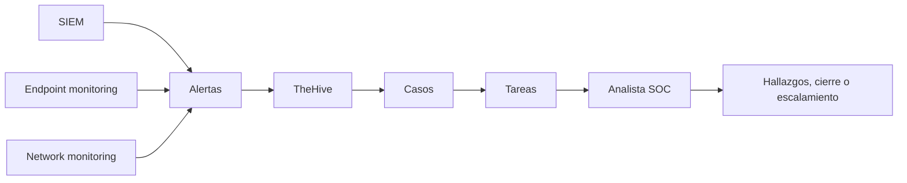

# Incident Management — TheHive

El instructor presenta Incident Management (IM) como una forma organizada de administrar los incidentes: asignar prioridades, responsables, tareas, evidencias y conclusiones.

## Alert, Case y Task

| | Qué significa |
|---|---|
| Alert | Un aviso que necesita validación |
| Case | La investigación organizada sobre una situación |
| Task | Una acción concreta dentro del caso |

## Lo que se vio en la demostración

En la captura de TheHive aparecen **20 casos**. Entre ellos:

- **#20:** `/etc/passwd file modification detected`.
- **#19:** `Linpeas activity detected`.
- **#18:** `Suspicious scheduled task created`.
- **#17:** `Suspicious .SH file detected`.

Se observan estados como `New`, prioridades y tareas. Son datos **del entorno mostrado en el video**, no casos investigados personalmente.

El instructor explica que un analista puede registrar los hallazgos —IP, dominios, URLs o hashes— y escalar el caso a otra persona si requiere una investigación más profunda.

## Ejemplo: modificación de /etc/passwd

Una alerta indica que cambió `/etc/passwd`. Antes de hablar de compromiso, hay que averiguar **quién hizo el cambio, cuándo, qué cambió y si había una operación autorizada**. Crear una cuenta de manera legítima también puede modificar ese archivo.

El cierre del caso debe indicar qué evidencia respalda la conclusión; si no se sabe, no conviene inventar un veredicto.

## Para recordar

El gestor de incidentes es como la carpeta compartida de una investigación: evita que los hallazgos queden solamente en la computadora o la memoria de un analista.

**Fuente:** BTF, pp. 54–56 y capturas de TheHive.
