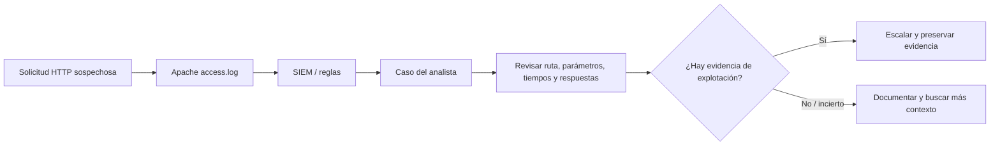

# First Line of Investigation — SQL Injection

El PDF termina con una introducción a la investigación de SQL injection: una entrada manipulada puede alterar una consulta SQL construida de forma insegura.

La clase muestra que el analista debe identificar el servicio, revisar registros web, comprobar los códigos de respuesta y correlacionar el evento con el SIEM y herramientas de monitoreo de red.

## Qué evidencia buscaría

1. **Servicio y ruta:** aplicación, endpoint y método HTTP.
2. **Ventana temporal:** a qué hora empezó la actividad y cuántas solicitudes hubo.
3. **Patrones de entrada:** parámetros y caracteres que se parecen a expresiones SQL inyectadas.
4. **Códigos de respuesta:** 200, 403, 500 y cambios relevantes de comportamiento.
5. **Origen y contexto:** IP, user-agent, sesiones y solicitudes próximas.
6. **Correlación:** eventos de la aplicación, WAF, SIEM y base de datos, cuando existan.

Un patrón como `' OR 1=1 --` puede indicar un **intento** de SQL injection, pero encontrarlo en una URL no demuestra que la consulta de la base de datos se haya modificado ni que la explotación haya tenido éxito.

En el PDF (pp. 58–61) hay una explicación conceptual de SQLi y un diagrama de investigación. La demostración práctica completa no está incluida en las páginas recibidas, así que **no afirmo haberla realizado**.

## Mini ejemplo

Si Apache registra muchas peticiones a una ruta de login con entradas sospechosas y luego aparecen errores 500, investigaría si hay una vulnerabilidad o simplemente un filtro que bloqueó los intentos. Revisaría logs de aplicación y base de datos antes de concluir.

**Fuente:** BTF, pp. 57–62. Procedimiento defensivo complementario.
