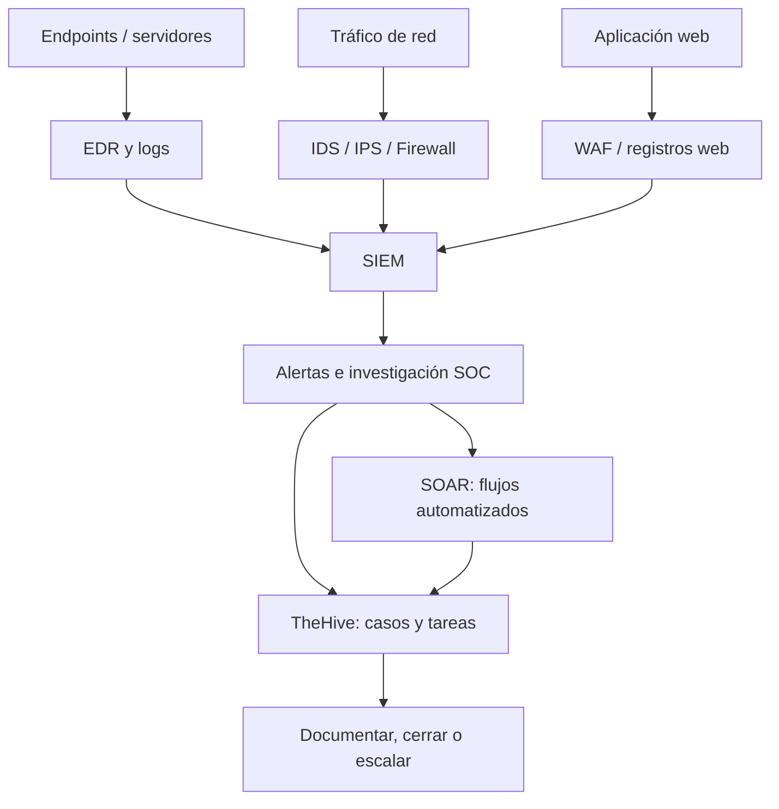

# BTF — Cyber Operations

Estos son mis apuntes del módulo de operaciones de seguridad. El objetivo es entender cómo trabaja un SOC y para qué sirve cada herramienta, sin memorizar solamente siglas.

Seguí las diapositivas de **CyberWarFare Labs, Module 02 — Introduction to Cyber Operations** y las capturas de las explicaciones y demostraciones en video. En la plataforma lo estamos trabajando como el tercer bloque; la numeración del PDF es distinta.

## Apuntes

| Tema | Archivo |
|---|---|
| Funcionamiento del SOC, roles, fases y SOCaaS | [01 — Operaciones SOC](01-fundamentos-y-flujo-soc.md) |
| Firewall, WAF y NGFW | [02 — Firewalls](02-firewall-waf-ngfw.md) |
| Forward/reverse proxy y túneles VPN | [03 — Proxy y VPN](03-proxy-y-vpn.md) |
| Detección y prevención de intrusiones | [04 — IDS e IPS](04-ids-e-ips.md) |
| Recolección, normalización, indexación y alertas | [05 — Arquitectura SIEM](05-siem-arquitectura.md) |
| Consultas reales mostradas por el instructor | [06 — Demo Wazuh](06-wazuh-demo.md) |
| Análisis y respuesta en endpoints | [07 — EDR](07-edr.md) |
| Automatización de un reporte de phishing | [08 — SOAR](08-soar.md) |
| Casos, tareas y escalamiento en TheHive | [09 — Incident Management](09-incident-management-thehive.md) |
| TP, FP, TN y FN | [10 — Clasificación de detecciones](10-true-false-positive.md) |
| Análisis inicial de SQL injection desde logs | [11 — First Line of Investigation](11-first-line-investigation.md) |

## Cómo relaciono las herramientas

No es una arquitectura de producto universal; es una forma sencilla de relacionar los componentes vistos en clase.

## Estado de estudio

- [x] Apuntes de teoría y capturas compartidas.
- [x] Diagramas de arquitectura y flujos en Mermaid.
- [x] Ejemplos y analogías para repasar.
- [ ] Reproducir la demo de Wazuh por cuenta propia.
- [ ] Ejecutar una investigación completa de un caso en TheHive.
- [ ] Completar la demostración práctica de SQLi del curso.

## Referencia

*Blue Team Fundamentals — Introduction to Cyber Operations*, CyberWarFare Labs, PDF de 63 páginas y capturas del video compartidas durante el estudio. Los ejemplos inventados se presentan como tales. No se incluye una copia de las diapositivas originales.
