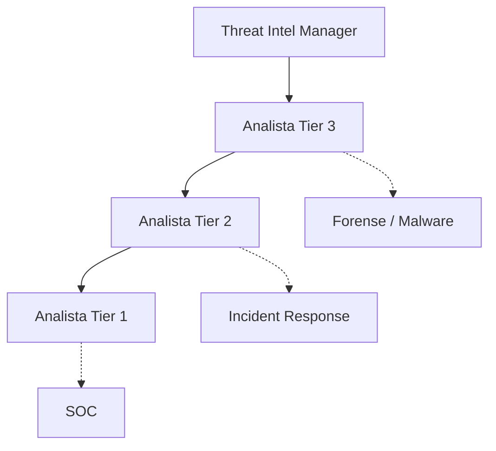
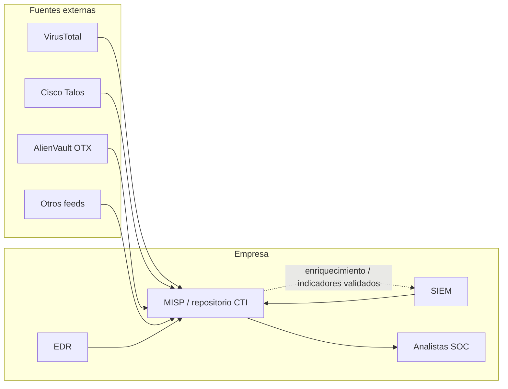

# 01 — Fundamentos y fuentes de Threat Intelligence

## ¿Qué es CTI?

**Cyber Threat Intelligence (CTI)** es recoger, procesar, analizar y compartir información sobre amenazas para que sirva al tomar decisiones. No basta con encontrar una IP sospechosa; hay que determinar por qué importa, a qué sistemas afecta y qué acción corresponde.

**Analogía:** el SOC es el equipo de guardia que ve movimiento en las cámaras. CTI investiga si esa persona ya estuvo vinculada a robos, cómo opera y qué puertas suele usar. Luego vuelve con información que permite actuar mejor.

En el curso se presenta una estructura orientativa de **Threat Intel Manager → Tier 3 → Tier 2 → Tier 1**. No todas las empresas organizan CTI así. El equipo colabora con SOC, respuesta a incidentes, análisis de malware y forense.

## ¿De dónde sale la inteligencia?

| Fuente que presenta el curso | Ejemplos | Para qué me sirve |
|---|---|---|
| Interna | Logs SIEM, EDR, tickets, análisis de malware | Detectar lo que realmente ocurre en mi organización |
| Técnica / externa | VirusTotal, Cisco Talos, AlienVault OTX, feeds | Comparar y enriquecer indicadores |
| Humana y abierta | Publicaciones de investigadores, reportes, foros, redes sociales | Encontrar campañas, contexto y nuevas técnicas |

La clase usa como ejemplo un reporte publicado en redes sobre **Trigona ransomware** y menciona foros de la dark web. Importante: encontrar una publicación no significa que todo su contenido esté verificado. Hay que comprobar fecha, fuente, evidencia y pertinencia.

### Ejemplo

El SIEM registra conexiones hacia un dominio que no conozco. Primero reviso los logs internos (quién se conectó, cuándo, frecuencia, procesos relacionados). Después consulto fuentes externas y busco reportes que expliquen ese dominio. Finalmente documento si encontré señales suficientes para escalar.

## Cómo encajan MISP y las fuentes externas

En la presentación, el flujo contempla intercambios con fuentes externas, almacenamiento de inteligencia interno y uso por herramientas de monitoreo. **La integración automática requiere configuración**: el dibujo no significa que todas esas plataformas sincronicen por defecto.

## Panorama de amenazas

El PDF menciona cuatro familias de escenarios: **ransomware**, **APTs**, **ataques a la cadena de suministro** y **phishing/ingeniería social**.

- Ransomware: malware que puede cifrar archivos y exigir un rescate.
- APT: campañas sofisticadas que pueden mantener acceso no autorizado durante periodos prolongados.
- Supply chain: el compromiso llega a través de un proveedor, dependencia o componente confiado.
- Phishing: engaño para inducir a alguien a entregar credenciales o ejecutar una acción.

> Nota de lectura: el PDF menciona un porcentaje de 66 % sobre ataques a la cadena de suministro sin indicar metodología o referencia. No lo tomo como estadística verificada.

## Preguntas para comprobar si lo entendí

1. ¿Qué información necesito para convertir una IP sospechosa en un hallazgo útil?
2. ¿Por qué una fuente externa no reemplaza mis propios logs?
3. ¿Qué datos de una alerta entregaría a CTI y cuáles devolvería CTI al SOC?

**Material base:** diapositivas 3–16 y 23–28 del PDF BTF; explicación en vídeo sobre fuentes internas, técnicas y humanas.
