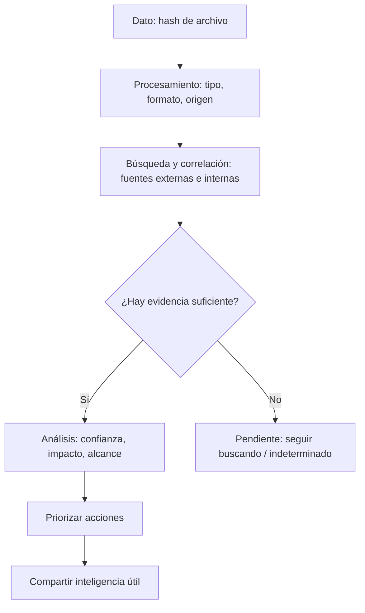
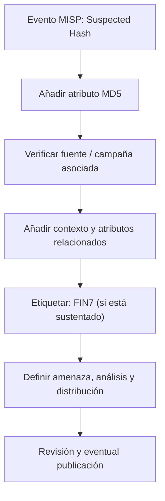

# 02 — De un dato crudo a inteligencia (y cómo entra MISP)

La parte que más me interesa es el recorrido de un dato: desde un hash sacado de un archivo sospechoso hasta una decisión que otro analista pueda utilizar.

## Dato, información, inteligencia

- **Dato:** `732e6d3d7534da31f51b25506e52227a` (un hash MD5 del ejemplo del curso).
- **Información:** ese hash aparece citado en un reporte de una actividad relacionada con FIN7.
- **Inteligencia:** tras validar el contexto y su relación con mis sistemas, determino qué debo buscar, con qué prioridad y a quién informar.

Que el valor aparezca en una lista **no prueba por sí solo** que mi empresa esté comprometida o que la atribución sea definitiva.

## Las tres fases del material

**Fase 1 — fuentes externas.** Se buscan feeds y reportes: VirusTotal, Talos y OTX, entre otros. En el ejemplo también aparece MISP como plataforma para reunir inteligencia.

**Fase 2 — fuentes internas.** El SOC, EDR, análisis de malware y forense aportan URL, IP, dominio, archivos y hashes detectados en el entorno. Se valida si merecen ser agregados a la base de inteligencia.

**Fase 3 — procesamiento, análisis y difusión.** Se contextualiza lo recolectado, se evalúa severidad e impacto, se documenta y se comparte con equipos o controles pertinentes.

La diapositiva de *Raw Data to Intelligence* lo presenta además en cinco pasos: **colección → procesamiento → análisis → priorización → compartir y colaborar**.

## Demostración del vídeo: un hash sin resultados claros

1. El analista parte del MD5 `732e6d3d7534da31f51b25506e52227a`.
2. Busca en **VirusTotal**. En la demostración no se obtiene una coincidencia concluyente.
3. Prueba también en **Cisco Talos**; tampoco obtiene un resultado útil en pantalla.
4. Realiza búsqueda pública por el hash exacto.
5. Encuentra un reporte de CloudSEK asociado al grupo **FIN7/Carbanak**, donde se lista ese indicador.
6. El reporte permite aportar contexto a la investigación, que luego se documenta en el portal de inteligencia.

**Lo que aprendí:** «sin resultados» no equivale a «limpio». Y «aparece en un reporte» no equivale automáticamente a «incidente confirmado». Importan la procedencia y la evidencia.

### Dónde buscar

- [VirusTotal](https://www.virustotal.com/)
- [Cisco Talos Intelligence](https://talosintelligence.com/)
- [AlienVault OTX](https://otx.alienvault.com/)
- [MISP](https://www.misp-project.org/)
- [MITRE ATT&CK](https://attack.mitre.org/)

No subir archivos internos, muestras privadas ni información de clientes a servicios públicos sin autorización: las condiciones de intercambio pueden exponer el material a terceros. En un entorno laboral, preferir la consulta de hash cuando sea apropiado y esté autorizada.

## MISP: qué hizo el instructor

En el ejemplo se abre un evento titulado **Suspected Hash**, se añaden atributos de tipo **md5**, se busca el contexto externo, se completa el evento con otros indicadores relacionados y se crea una etiqueta **FIN7 Crime Gang**. También muestra opciones de nivel de amenaza, análisis y distribución.

### Campos que no debo rellenar a ciegas

| Campo | Qué revisaría |
|---|---|
| Category / Type | Si el indicador es md5, IP, URL, dominio, etc. |
| Value | Valor correcto, sin errores de copia |
| Comment | De dónde salió, cuándo y por qué se agregó |
| Tags | Campaña o actor solo si hay justificación |
| Threat level | Riesgo evaluado, no supuesto |
| Analysis | Inicial, en curso o completado |
| Distribution | Quién está autorizado a ver los datos |

**Ojo con la demostración:** muestra un procedimiento de MISP, no un ejercicio ejecutado por mí. Todavía me falta repetirlo en un entorno de laboratorio y capturar mis propias evidencias.

**Material base:** diapositivas 9, 15–22 y 17–21 del PDF; demostraciones del vídeo con VirusTotal, Talos, búsquedas web y MISP.
