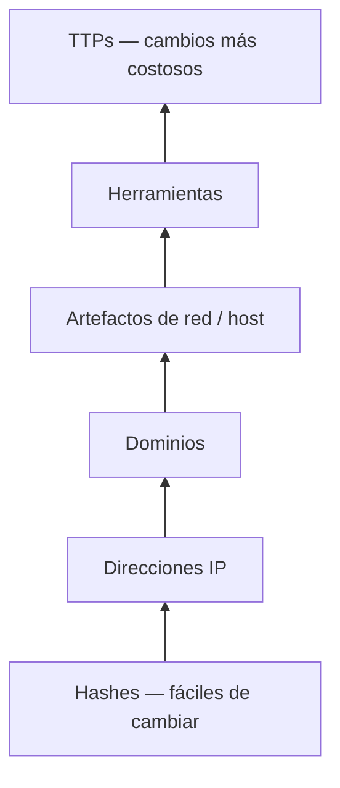
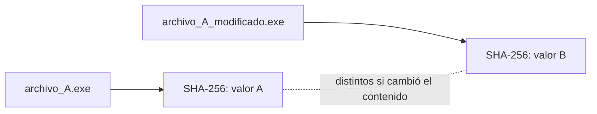
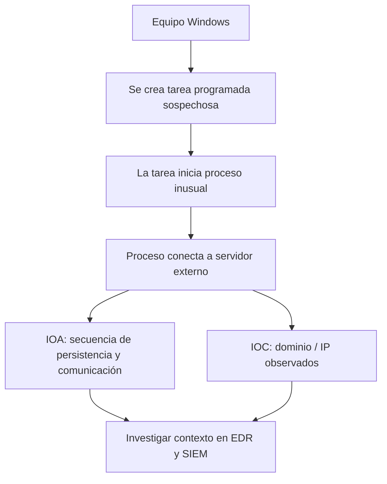

# 03 — Pyramid of Pain, IOC e IOA

La **Pyramid of Pain** de David J. Bianco (2013) plantea una idea bastante práctica: cuanto más costoso sea para un atacante cambiar lo que estoy detectando, más lo obligo a adaptar su operación.

No significa que los indicadores de abajo no sirvan. Un hash conocido permite actuar rápido; el problema es depender solo de él.

## Pirámide — de menor a mayor dificultad para el atacante

En las diapositivas del curso las secciones superiores se agrupan gráficamente; aquí las separé para distinguir sus **seis niveles tradicionales**.

| Nivel | Qué puede detectar el analista | Cómo puede adaptarse el atacante |
|---|---|---|
| Hash | Huella de un archivo conocido | Modifica el contenido y cambia el hash |
| IP | Conexión hacia origen o destino sospechoso | Cambia de IP, infraestructura, proxy o salida VPN |
| Dominio | Nombre vinculado a actividad maliciosa | Sustituye por otro dominio |
| Artefactos | Registro, archivos, tareas programadas, patrones de tráfico | Tiene que alterar más partes de su actividad |
| Herramientas | Indicadores o comportamientos de herramientas específicas | Cambia o modifica la herramienta |
| TTPs | Técnicas y procedimientos utilizados | Necesita modificar la forma en que ejecuta el ataque |

### Analogía que me ayuda

Si intento reconocer a alguien por **su camiseta**, basta que se cambie de ropa. Si reconozco **la manera en que entra, se mueve y actúa**, ya no basta con cambiar la camiseta: tendría que cambiar su rutina.

Eso es lo que busco al detectar TTPs.

## Hashes: exactos, pero frágiles ante cambios

MD5 y SHA-256 se utilizan para calcular huellas digitales de archivos. Si un archivo cambia, normalmente cambia su hash. Por eso sirven para identificar exactamente una muestra, pero la coincidencia puede perderse con una variante.

**Aclaración técnica:** MD5 tiene debilidades criptográficas; para verificar integridad es preferible SHA-256. Ningún hash por sí mismo decide si un programa es malicioso.

## IP y dominio

Bloquear una IP sirve para contener tráfico identificado, pero otro servidor, proxy o VPN puede cambiar la dirección visible. También se puede registrar otro dominio para mantener una operación. Por eso hay que acompañar los bloqueos con contexto y señales de comportamiento.

## Artefactos de host y red

**Host:** cambios del registro, tareas programadas, ejecutables nuevos, archivos soltados en disco. **Red:** patrones de conexiones, solicitudes DNS o tráfico anómalo.

Ejemplo de la clase: un script crea una tarea programada para ejecutarse de forma persistente. Si detecto esa técnica, el atacante debe cambiar algo más que un dominio.

## Herramientas y TTPs

La clase menciona herramientas como Mimikatz y CrackMapExec a modo de ejemplo. Una detección enfocada en una herramienta puede perder eficacia ante variantes. Una detección del comportamiento suele ser más flexible, aunque también requiere pruebas y ajuste.

**TTP = Tactics, Techniques and Procedures.** Una táctica responde *para qué*, una técnica *cómo en términos generales* y un procedimiento *cómo se ejecutó concretamente*.

Ejemplo ilustrativo: objetivo de acceso inicial → explotación de una aplicación expuesta → secuencia concreta de solicitudes y ejecución observada.

## IOC vs IOA

| IOC — Indicator of Compromise | IOA — Indicator of Attack |
|---|---|
| Una evidencia o indicador asociado a compromiso | Una señal de comportamiento de ataque |
| Hash conocido, IP, dominio, artefacto | Secuencia de procesos, persistencia seguida de comunicación |
| Útil para búsqueda retrospectiva y correlación | Útil para detectar operaciones por patrones |
| Puede perderse si cambia el indicador | Puede detectar variantes, pero también tener falsos positivos |

**Ejemplo conectado:**

En el material se dice que los IOC son más históricos y los IOA más orientados a detección en tiempo real. Es una forma introductoria de distinguirlos, **no una regla absoluta**: un IOC también puede bloquear en tiempo real y un IOA puede investigarse retrospectivamente.

### Regla personal

Una IP aislada me dice **dónde ocurrió algo**; una secuencia de ejecución puede decirme **qué intentaba hacer alguien**. Necesito ambas miradas para investigar bien.

**Material base:** diapositivas 29–45 del PDF y explicación oral de la Pyramid of Pain, hash, IP, dominio, artefactos, herramientas, TTP, IOC e IOA.
