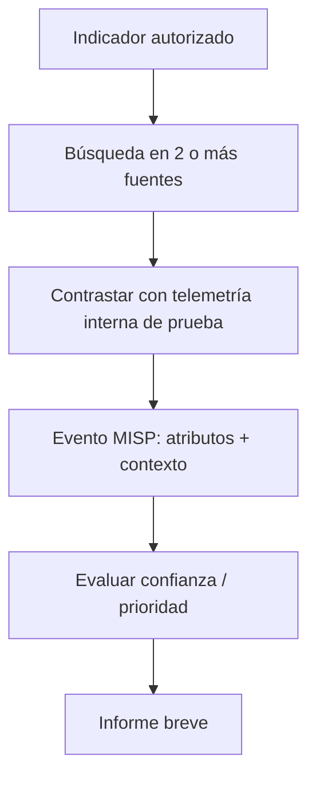

# 04 — Práctica y repaso

## Mini proyecto: de un indicador a una hipótesis de ataque

**Objetivo:** reproducir en un entorno autorizado una investigación parecida a la de la clase y dejar evidencias verificables.

### Parte A — Investigación de un hash

1. Elegir una muestra de prueba inocua o un indicador publicado en un reporte de CTI. No descargar ni ejecutar malware.
2. Registrar hash, origen, fecha y herramienta que lo generó.
3. Buscar el indicador en VirusTotal y otras fuentes públicas.
4. Anotar resultados exactos, incluidos los negativos y las fuentes sin datos.
5. Evaluar si hay información adicional suficiente para construir una hipótesis.
6. Documentar qué se sabe, qué no se sabe y qué validación falta.

| Evidencia | Resultado |
|---|---|
| Hash y algoritmo | Pendiente |
| Fuente original y fecha | Pendiente |
| VirusTotal | Pendiente |
| Talos / otra fuente | Pendiente |
| Reporte o referencia | Pendiente |
| Confianza en la hipótesis | Pendiente |
| Acción recomendada | Pendiente |

### Parte B — Evento en MISP (laboratorio)

Crear un evento de prueba y adjuntar únicamente datos ficticios o autorizados. Añadir un atributo, comentario, origen, una etiqueta justificada y definir su distribución. Registrar capturas **sin credenciales ni datos sensibles**.



### Parte C — Detecciones más resistentes

Proponer dos reglas conceptuales (sin afirmar que ya funcionan):

- **IOC:** alerta si se observa comunicación a un dominio de prueba listado.
- **IOA:** alerta ante combinación de creación inesperada de tarea programada + proceso inusual + comunicación saliente.

Preguntarme: ¿qué dato necesito capturar?, ¿qué comportamiento benigno se parece?, ¿cómo validaría falsos positivos?

## Ejemplo de ficha CTI

```text
CASO: CTI-001
Fecha:
Indicador:
Origen:
Qué observé:
Fuentes contrastadas:
Relación con mi entorno:
Hipótesis:
Nivel de confianza:
Riesgo y prioridad:
Acción recomendada:
Pendiente de validar:
Evidencias:
```

## Preguntas de examen

1. ¿Cuál es la diferencia entre dato, información e inteligencia?
2. ¿Qué fuentes internas usaría un analista de CTI?
3. ¿Por qué no debo dar por limpio un hash que no aparece en VirusTotal?
4. ¿Qué hace MISP y qué información debería tener un evento?
5. ¿Por qué un hash suele ubicarse abajo en la Pyramid of Pain?
6. ¿Qué cambia cuando detecto una técnica de persistencia y no solo un archivo?
7. ¿Qué es un artefacto de host? Da dos ejemplos.
8. ¿Qué diferencia hay entre un IOC y un IOA?
9. ¿Por qué cambiar de IP no elimina todos los rastros de un atacante?
10. ¿Qué necesita una detección basada en comportamiento para evitar falsos positivos?

## Mi checklist

- [x] Revisé el material del curso (lectura y capturas).
- [x] Dejé apuntes y diagramas.
- [ ] Realicé una investigación con evidencias propias.
- [ ] Creé y documenté un evento MISP real de laboratorio.
- [ ] Probé una regla basada en IOC y otra basada en IOA.
- [ ] Escribí un informe corto con hallazgos, limitaciones y siguientes pasos.

**Nota:** el ejemplo de FIN7 y los pantallazos de MISP pertenecen a la demostración del curso; aún no son evidencias de una práctica propia.
