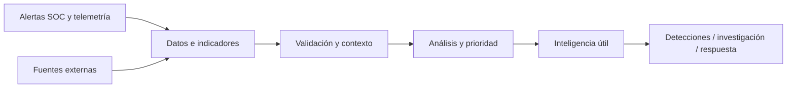

# Threat Intelligence — apuntes BTF

> Curso: Blue Team Fundamentals, CyberWarFare Labs. En la presentación figura como **Module 03 — Cyber Threat Analysis and Intelligence**; en mi avance lo estoy trabajando como capítulo 4.

Esta parte conecta bastante con el trabajo de SOC. En vez de mirar una alerta aislada, la idea es entender qué significa, de dónde salió y si está relacionada con una amenaza real. Reunir miles de IP y hashes no sirve demasiado si nadie los analiza.

## Contenido

1. [Qué es CTI, fuentes y arquitectura](01-fundamentos-y-fuentes.md)
2. [De datos crudos a inteligencia: VirusTotal, Talos y MISP](02-ciclo-cti-y-misp.md)
3. [Pyramid of Pain, indicadores, IOC e IOA](03-pyramid-of-pain-ioc-ioa.md)
4. [Ejercicios, repaso y mini proyecto](04-practica-y-repaso.md)

## Vista rápida del flujo

No confundir una lista de indicadores con inteligencia terminada: necesito contexto, confianza y una acción concreta.

## Qué debería poder hacer al terminar

- Distinguir inteligencia de amenazas de simples datos recolectados.
- Investigar indicadores sin concluir que son maliciosos por un único resultado.
- Registrar una investigación en MISP con atributos, etiquetas, contexto y nivel de distribución razonable.
- Entender por qué detectar comportamientos y TTPs suele ser más sólido que buscar solo hashes o IP.
- Explicar la diferencia entre IOC e IOA con ejemplos de un host Windows.

**Fuente principal:** PDF y demostraciones del curso BTF de CyberWarFare Labs. Los ejemplos, analogías y ejercicios redactados aquí son apuntes personales para estudiar, no resultados de laboratorios propios ya ejecutados.
