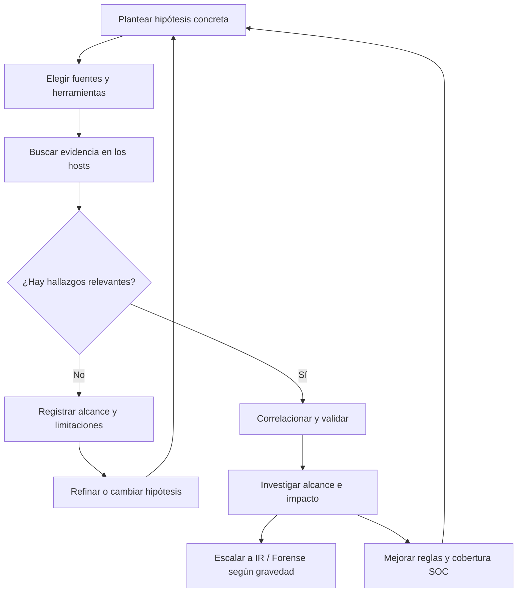

# Threat Hunting: conceptos, hipótesis y ciclo de trabajo

> Apuntes del módulo de Cyber Threat Hunting de Blue Team Fundamentals (CWL). Redactados a partir de las diapositivas y la demostración compartida; no son un laboratorio personal ejecutado.

## 1. Qué se busca realmente

En un SOC normalmente partimos de una alerta. En **Threat Hunting** invertimos la lógica: formulamos una sospecha razonable y buscamos evidencia, aunque todavía no exista una alerta.

Ejemplo: «Puede que algún host mantenga persistencia mediante una tarea programada que ejecute un script no autorizado». Eso es una hipótesis investigable. «Buscar hackers» no lo es.

**Analogía:** el SOC actúa cuando suena la alarma del edificio. Un hunter revisa accesos, cerraduras y grabaciones para descubrir cómo alguien podría estar entrando sin activarla.

En el material, el hunting se describe como una actividad **proactiva** y **dirigida por hipótesis**, realizada con apoyo de especialistas que conocen tanto el funcionamiento del ataque como las herramientas defensivas. Colabora con SOC, respuesta a incidentes y análisis forense. No significa que los analistas junior no puedan practicarlo: significa que validar conclusiones requiere criterio.

## 2. Ciclo iterativo

Este bucle reúne las cuatro etapas de la presentación: **crear hipótesis → investigar con herramientas → descubrir patrones → mejorar la detección**.

### Cuatro preguntas antes de iniciar
- ¿Qué comportamiento sospecho y por qué?
- ¿Qué evidencia lo confirmaría o refutaría?
- ¿Qué equipos, periodo y sistemas cubre mi búsqueda?
- ¿Qué haré con los resultados?

## 3. Herramientas mencionadas

El curso nombra **HELK, APT-Hunter, THOR, DeepBlueCLI, LOKI y Velociraptor**. La demostración compartida trabaja especialmente con **Velociraptor**, que permite consultar artefactos de endpoints y recuperar resultados desde una consola central.

No hay que confundir herramienta con hipótesis: ejecutar un escáner sin saber qué buscamos produce hallazgos difíciles de interpretar.

## 4. Tres momentos del hunting vistos en clase

**Fase 1 — hipótesis:** se decide qué actividad buscar; por ejemplo, tareas o cron jobs poco habituales.

**Fase 2 — ejecución:** se escogen los artefactos, se configuran parámetros y recursos, y se lanza una búsqueda sobre endpoints seleccionados.

**Fase 3 — investigación y mejora:** se inspeccionan los resultados, se recupera el archivo sospechoso, se contrasta con otras fuentes y se propone seguimiento en SOC/IR.

El diagrama del curso presenta el mismo ciclo: si no aparecen indicios, se reformula la búsqueda; si aparecen, se estudia el comportamiento y se construyen detecciones nuevas.

## 5. Hipótesis de ejemplo para apuntes

> Hipótesis: uno o más equipos Linux podrían ejecutar scripts no autorizados mediante cron para restablecer una comunicación externa de forma periódica.

**Qué buscaría:** cron entries inusuales, rutas de scripts en ubicaciones de usuario, cambios recientes, propietario del archivo, contenido, procesos relacionados y tráfico saliente.

**Qué no afirmaría todavía:** que toda tarea cron es maliciosa o que un script desconocido demuestra una intrusión.

## 6. Notas de criterio

- **Persistencia** es un objetivo frecuente de las tareas programadas maliciosas, pero cron y Task Scheduler tienen innumerables usos legítimos.
- El hunting no termina al detectar un nombre extraño: hacen falta contexto y corroboración.
- Un resultado limpio de antivirus no descarta un script peligroso.
- Las reglas resultantes deberían basarse en señales verificables y ajustarse para limitar falsos positivos.

**Fuente:** presentación y demo «Cyber Threat Hunting» de CyberWarFare Labs (capturas/transcripción proporcionadas para estos apuntes).
