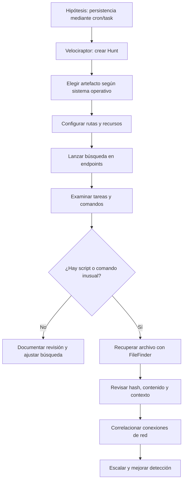
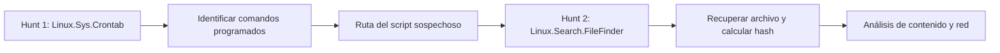

# Práctica guiada: buscar tareas programadas con Velociraptor

> **Reproducción documentada del vídeo, no ejecución propia.** Las pantallas son del laboratorio del curso. Se describe la secuencia y se explican los campos relevantes, sin presentar sus hallazgos como obtenidos en mi entorno.

## 1. Contexto

La demostración plantea una amenaza de **persistencia**: un atacante que ya obtuvo acceso podría dejar una tarea programada para volver a ejecutar un script, incluso después de perder una conexión.

**Analogía:** una tarea programada es como una alarma despertador. Puede abrir el sistema de respaldos todas las noches (legítimo) o iniciar un programa no autorizado cada minuto (sospechoso). La función de programar no es el problema: lo importante es **qué ejecuta, quién la creó y para qué**.

### Cadena de investigación



## 2. Artefactos y selección correcta

En el vídeo aparecen dos familias que **no son intercambiables**:

| Sistema | Artefacto mostrado | Qué permite revisar |
|---|---|---|
| Windows | `Windows.System.TaskScheduler` | Definiciones de tareas programadas y sus comandos |
| Linux | `Linux.Sys.Crontab` | Entradas cron en ubicaciones habituales |
| Linux | `Linux.Search.FileFinder` | Ubicación y recuperación de un archivo concreto |

La demostración ejecuta la búsqueda de cron sobre **tres máquinas del laboratorio**, pero la infraestructura puede contener hosts de diferentes sistemas. Conviene verificar primero el sistema operativo de los clientes seleccionados.

## 3. Configuración del primer Hunt

Secuencia observada:

1. Abrir Velociraptor y entrar al administrador de **Hunts**.
2. Crear una nueva búsqueda con descripción, por ejemplo `Scheduled Task Hunt`.
3. En **Select Artifacts**, escoger `Linux.Sys.Crontab` para máquinas Linux.
4. En **Configure Parameters**, revisar las rutas por defecto.
5. En **Specify Resources**, comprobar límites antes de ejecutar.
6. En **Review / Launch**, revisar selección y lanzar.
7. Consultar **Overview**, **Clients** y los resultados de cada flujo.

### Parámetros mostrados en pantalla

```text
cronTabGlob:
/etc/crontab,/etc/cron.d/**,/var/at/tabs/**,/var/spool/cron/**,/var/spool/cron/crontabs/**

cronTabScripts:
/etc/cron.daily/*,/etc/cron.hourly/*,/etc/cron.monthly/*,/etc/cron.weekly/*
```

Estos valores representan las rutas configuradas en **ese laboratorio**. No se debe asumir que cubren toda distribución Linux ni copiar ciegamente los glob sin revisar los permisos y la versión del artefacto.

Los controles vistos incluyen `Ops/Sec`, tiempo máximo por artefacto, máximo de filas y tamaño de subida. La pantalla muestra como referencias **600 s**, **1 000 000 filas** y **aproximadamente 1 GB**. Son valores de la demostración, **no recomendaciones universales para producción**.

## 4. Leer la salida en lugar de contar solo filas

Velociraptor devuelve información por cliente/flujo. El ponente explica que las tres máquinas tienen diferentes cantidades de resultados. La comparación útil no es «una tiene más tareas que otra», sino:

- ¿La tarea es esperable para esa distribución o aplicación?
- ¿Quién la ejecuta?
- ¿Cuál es su frecuencia?
- ¿Qué comando y ruta están definidos?
- ¿El script tiene un propósito y propietario conocidos?
- ¿Existen fechas, procesos o conexiones que lo relacionen con una intrusión?

### Ejemplo del vídeo

Entre las entradas observadas aparece una ruta de script del laboratorio:

```text
/home/bt-emp01/Desktop/testing/testing.sh
```

El vídeo la identifica como sospechosa y continúa con una segunda búsqueda para obtener el archivo. **No es prueba de malware por sí sola**: es una señal a analizar.

## 5. Segundo Hunt: recuperar el script

Se crea una nueva búsqueda mediante `Linux.Search.FileFinder`.

En la pantalla de configuración se observa:

```text
SearchFilesGlob = /home/bt-emp01/Desktop/testing/testing.sh
Upload_File     = habilitado
Calculate_Hash  = habilitado
```

Se configuran los límites, se revisa la solicitud y se lanza la búsqueda. Después se abren los resultados del cliente que devolvió el archivo y se descarga el artefacto para analizarlo en un **entorno aislado**.

En el caso del vídeo, no todos los clientes devolvieron un resultado; eso es normal si la ruta no existe en todos. El resultado del cliente relevante permite acceder al archivo y al hash.

### Por qué los dos Hunts son distintos



El primero responde **qué se está ejecutando**. El segundo ayuda a conocer **qué contiene el archivo ejecutado**.

## 6. Qué comprobar al terminar

- Registrar Hunt ID, host, instante y artefacto consultado.
- Conservar la tarea original y su comando; no modificar el equipo prematuramente.
- Guardar hash y copia del archivo respetando procedimientos de evidencia.
- Correlacionar proceso, DNS, IP, puerto y hora.
- Reportar a respuesta a incidentes si hay indicios corroborados.

**Fuente:** demostración «Suspicious Scheduled Task» del módulo Cyber Threat Hunting, CyberWarFare Labs. El caso está documentado a partir de pantallas y subtítulos compartidos.
