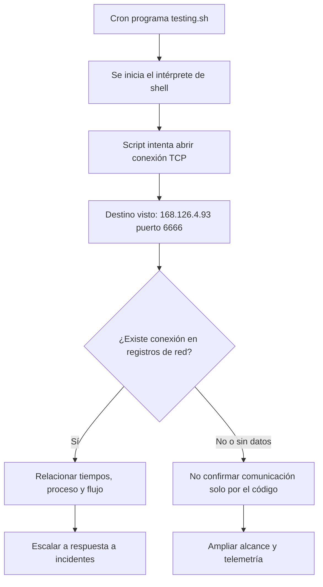

# Caso de estudio: cron sospechoso, script y verificación

> Continuación de la práctica observada en vídeo. Esta página separa lo **visto** de lo que **aún sería necesario confirmar**.

## 1. Hallazgo inicial

La búsqueda de tareas programadas permitió localizar una entrada que apunta a `/home/bt-emp01/Desktop/testing/testing.sh`. Posteriormente, `Linux.Search.FileFinder` recuperó una copia de ese script y calculó su hash.

El instructor consultó su reputación en VirusTotal mediante hash y archivo. En la captura mostrada no se observan detecciones de motores para la muestra consultada. **Eso no valida que el script sea benigno**, especialmente cuando contiene instrucciones de shell capaces de abrir conexiones.

## 2. Análisis estático del archivo

En la imagen del editor se observa una línea de shell con una apertura de conexión a:

```text
168.126.4.93:6666
```

La línea contiene redirecciones de descriptores de archivo y referencias a `/dev/tcp`, un mecanismo disponible en determinados intérpretes de shell para realizar conexiones TCP. La estructura es **compatible con una reverse shell o intento de comunicación hacia un controlador remoto**. No es necesario reproducir el payload para analizar su riesgo.

### Flujo del caso



**Importante:** la captura prueba el **contenido del script**, no que la conexión haya sido exitosa. El instructor indica que una validación posterior sería buscar tráfico en las herramientas de monitoreo de red.

## 3. ¿Por qué VirusTotal no lo detectó?

Posibles explicaciones (hipótesis generales, **no verificadas en este vídeo**):

- Algunos motores dan prioridad a binarios conocidos y no clasifican todas las variantes de scripts.
- La muestra puede ser poco frecuente o no estar previamente catalogada.
- Un resultado `0/N` significa «no detectado por esos motores en esa evaluación», no «seguro».

También hay que distinguir **hash** de **análisis de comportamiento**: consultar el hash solo permite recuperar reputación ya asociada a esa huella, mientras que inspeccionar contenido y ejecución permite hallar señales adicionales.

## 4. Qué buscar para confirmar o descartar la hipótesis

| Evidencia | Pregunta |
|---|---|
| Cron original | ¿A qué intervalos se ejecuta y con qué usuario? |
| Script y metadatos | ¿Cuál es el contenido, propietario, fecha y hash? |
| Procesos | ¿Se ejecutó el shell? ¿Con qué proceso padre? |
| Conexiones | ¿Se observó tráfico real a la IP y puerto de la captura? |
| Historial y auditoría | ¿Cuándo se creó o modificó la tarea? |
| Otros endpoints | ¿Se repite el patrón en otras máquinas? |

**Conclusión provisional del vídeo:** hay **indicios fuertes de un mecanismo de persistencia y comunicación remota** en el script de la máquina del laboratorio. El alcance y la comunicación efectiva requieren correlación adicional; no deben afirmarse como hechos confirmados.

## 5. Analogía para recordar

Un portero descubre que alguien programó una puerta para abrirse cada minuto. Consultar el nombre del dispositivo en una lista negra no arroja resultados, pero revisar la configuración muestra que intenta abrir un acceso externo. La ausencia en la lista negra no elimina el problema. El siguiente paso es comprobar los registros de apertura y determinar quién programó el mecanismo.

## 6. Lecciones para un SOC

- **Detectar**: tareas cron con scripts en rutas poco habituales, cambios recientes o comunicaciones externas inesperadas.
- **Investigar**: recoger archivo, cron, contexto de usuario y telemetría; no tomar una decisión por una sola señal.
- **Responder**: entregar al equipo de IR los hallazgos y el alcance con identificadores verificables.
- **Mejorar**: crear o afinar detecciones a partir de patrones observados (no solo de una IP concreta).

## 7. Autoevaluación rápida

1. ¿En qué se diferencia un hunt de la revisión normal de alertas SOC?
2. ¿Por qué una entrada cron no es maliciosa automáticamente?
3. ¿Qué devuelve `Linux.Sys.Crontab` y qué permite hacer `Linux.Search.FileFinder`?
4. ¿Qué diferencia hay entre encontrar un script que intenta conectar y comprobar que conectó?
5. ¿Por qué `0/N` en VirusTotal no es una prueba de legitimidad?
6. ¿Qué evidencias enviarías al equipo de respuesta a incidentes?
7. Si no aparece ninguna tarea sospechosa, ¿la hipótesis se ha refutado por completo?
8. ¿Qué regla de detección construirías sin depender solo de IP/hash?

### Respuestas orientativas

1. En hunting se formula una hipótesis y se busca evidencia proactivamente.
2. Es un mecanismo administrativo legítimo; importa el contexto y la acción.
3. El primero enumera cron; el segundo busca/recupera archivos específicos.
4. La instrucción es intención o capacidad; el flujo de red es evidencia de actividad efectiva.
5. Solo refleja que los motores consultados no lo marcaron en ese análisis.
6. Host, usuario, cron, ruta, archivo, hash, proceso, conexiones y marcas temporales.
7. No necesariamente: puede faltar cobertura, permisos o fuentes.
8. Correlación de cron anómalo + intérprete de shell + conexión saliente inusual.

**Fuente de la práctica:** vídeo y capturas del curso Blue Team Fundamentals, CyberWarFare Labs. No se han ejecutado estas búsquedas en un entorno propio.
