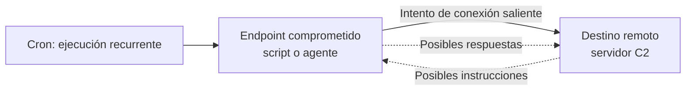
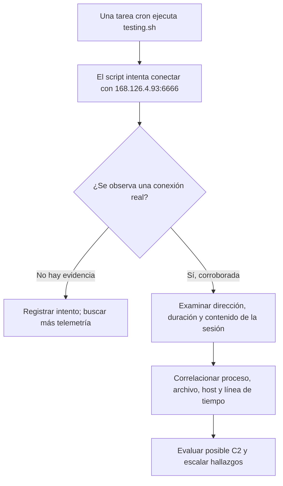

# C2 (Command and Control): qué es y cómo investigarlo

> Notas de estudio del módulo 04 de **Blue Team Fundamentals (CyberWarFare Labs)**. El caso de `testing.sh` procede de la demostración del curso, **no de una investigación ejecutada por mí**.

## 1. La idea en una frase

Un canal **Command and Control (C2)** permite que un atacante mantenga comunicación con un sistema comprometido para enviar instrucciones y, según el malware, recibir resultados. **No es lo mismo que persistencia**: C2 describe la comunicación; persistencia, cómo intenta sobrevivir o reactivarse el acceso.

Pienso en alguien dentro de un edificio hablando por radio con una persona afuera. El que está dentro puede recibir instrucciones y reportar lo que encuentra. La radio sería el canal C2; una alarma que lo obligara a volver a llamar cada cierto tiempo sería comparable a una tarea programada.

## 2. Esquema de una posible sesión C2



**Importante:** este dibujo representa un comportamiento posible. Una línea en el código hacia una IP **no confirma** que la comunicación se haya completado.

## 3. Relación con el ejemplo de Velociraptor

En las páginas **19–20, 31, 43–45** del PDF se muestra un escenario de persistencia con tareas cron y el script:

```text
/home/bt-emp01/Desktop/testing/testing.sh
```

El analista recupera ese archivo con `Linux.Search.FileFinder` y, al revisarlo en un editor, observa una conexión dirigida a:

```text
168.126.4.93:6666
```

El código enseñado utiliza la funcionalidad `/dev/tcp` de Bash para intentar una conexión TCP y tiene características de **reverse shell**.

| Pieza observada | Interpretación |
|---|---|
| `cron` | Puede relanzar el script periódicamente |
| `testing.sh` | Archivo que merece una inspección detallada |
| `/dev/tcp` | Funcionalidad de Bash relacionada con conexiones TCP |
| `168.126.4.93` | Dirección IP de destino escrita en el script |
| `6666` | Puerto TCP de destino |
| `sh` | Shell utilizado por el código |

### Persistencia y C2 no son sinónimos



La tarea programada podría explicar *cómo vuelve a arrancar* el script. La conexión hacia fuera podría explicar *con quién intenta hablar*. Hace falta evidencia de red y ejecución para sostener que hubo una sesión C2.

## 4. ¿Qué buscaría desde el Blue Team?

1. **Endpoint:** qué proceso abrió la conexión, cuál fue su padre y bajo qué usuario se ejecutó.
2. **Persistencia:** ruta del cron, frecuencia, propietario, comando y fecha de modificación.
3. **Red:** IP de origen, destino, puerto, marcas de tiempo, éxito o fallo de TCP y periodicidad.
4. **Contenido:** qué hacía el script, sin ejecutarlo en un equipo de producción.
5. **Inteligencia:** contrastar el destino y el hash con fuentes de reputación, sin convertir una coincidencia en prueba definitiva.

La diapositiva de la **página 45** propone un filtro de ejemplo para la búsqueda de tráfico:

```text
ip.src == 10.1.1.15 && ip.dst == 168.126.4.93 && port.dst == 6666
```

Es una **expresión mostrada en la clase**, no una sintaxis universal: hay que adaptarla al motor de consultas de la herramienta utilizada.

## 5. Qué NO debemos concluir

- Que un puerto poco habitual confirma malware.
- Que encontrar una IP en un archivo prueba una conexión exitosa.
- Que `0 detecciones` en VirusTotal significa que el archivo es seguro.
- Que toda tarea cron es maliciosa.
- Que todo canal C2 utiliza reverse shells. También hay agentes que consultan servidores mediante HTTP(S), DNS u otros protocolos.

## 6. Ubicación en los modelos

- **Cyber Kill Chain:** Command & Control es la **fase 6** del modelo de siete fases (páginas 68–70 del PDF).
- **MITRE ATT&CK:** la táctica **TA0011 — Command and Control** sirve para clasificar el objetivo del adversario. En este caso también podemos investigar `T1053.003 — Cron` y `T1059.004 — Unix Shell`, pero **no asignar una técnica C2 específica** sin mayor evidencia.

## 7. Mini checklist de investigación

- [ ] Identificar tarea, usuario, frecuencia y ruta del script.
- [ ] Recuperar y preservar el archivo sospechoso.
- [ ] Registrar hash y analizar contenido estático.
- [ ] Buscar conexiones relacionadas en la misma ventana de tiempo.
- [ ] Revisar procesos y correlación con la tarea cron.
- [ ] Contrastar IP/hash con inteligencia externa y contexto interno.
- [ ] Documentar qué está confirmado, qué es hipótesis y qué falta validar.
- [ ] Escalar a respuesta a incidentes cuando corresponda.

## 8. Preguntas de repaso

**1. ¿Qué diferencia C2 de persistencia?** C2 es la comunicación/control; persistencia intenta mantener o reactivar acceso.

**2. ¿Qué indica `168.126.4.93:6666` en el script?** Un destino TCP configurado, no una conexión demostrada.

**3. ¿Por qué sirve Velociraptor aquí?** Para enumerar cron, recuperar el script y reunir artefactos del endpoint que ayuden a formular y contrastar hipótesis.

**4. ¿Dónde buscar la confirmación?** En registros de procesos y conexiones, correlacionados con los tiempos de ejecución.

---

**Fuente de clase:** CyberWarFare Labs, *Blue Team Fundamentals — Module 04: Cyber Threat Hunting*, páginas 19–20, 23–45, 63–70; junto con las capturas y subtítulos de la demostración facilitados para estudiar. Las analogías, advertencias y diagramas son explicaciones propias añadidas al apunte.
