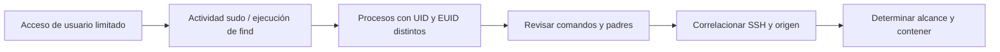
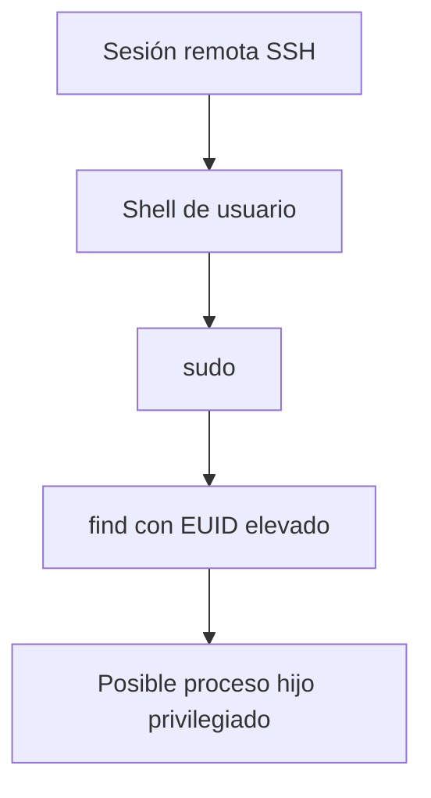

# Hunting de escalada de privilegios: Wazuh y osquery

> Apuntes a partir de las **páginas 46–61** de *BTF Module 04 — Cyber Threat Hunting*. La demostración pertenece al curso, no a un laboratorio que yo haya ejecutado.

## 1. Escenario de investigación

La escalada de privilegios ocurre cuando alguien que ya tiene acceso con permisos limitados consigue ejecutar operaciones con un nivel superior al autorizado. El ejemplo del curso parte de un usuario de bajos privilegios y examina actividad asociada con **sudo**, el proceso **find** y conexiones SSH.

**Analogía:** tener credenciales para entrar a recepción no equivale a tener la llave del cuarto de servidores. Si una aplicación o configuración permite usar esa llave sin autorización, hay una posible escalada.



## 2. Hipótesis y evidencia esperada

**Hipótesis del curso:** una cuenta de bajo privilegio podría haber usado un comando o servicio para ejecutar acciones con permisos elevados sin autorización.

Evidencia: registros de autenticación, identidad de quien invocó sudo, comando ejecutado, diferencias UID/EUID, árbol de procesos y origen de conexión SSH.

## 3. Paso 1 — buscar actividad sudo

El curso usa la consola de Wazuh/ELK y el filtro:

```text
predecoder.program_name: sudo and location: /var/log/auth.log
```

Se busca actividad registrada de `sudo` en `/var/log/auth.log`. **Matiz importante:** esto no enumera necesariamente todos los inicios de sesión de root: filtra eventos de un programa y archivo determinados. En otras distribuciones la ruta de autenticación puede ser distinta.

## 4. Paso 2 — identificar al usuario y al comando

Filtro mostrado en la **página 54**:

```text
predecoder.program_name: sudo and location: /var/log/auth.log and data.srcuser: emp01
```

En la **página 55**, el instructor observa actividad atribuida a `emp01`, incluyendo una línea relacionada con `/usr/bin/find` y otra con ejecución de una shell. La pregunta es: **¿por qué `find`, una herramienta para localizar archivos, se está usando en una operación privilegiada?**

No basta con el nombre del proceso: habría que revisar la línea completa, contexto, configuración de sudo y si la operación estaba autorizada.

## 5. Paso 3 — comprobar UID frente a EUID con osquery

Consulta de la **página 57**:

```sql
SELECT parent, pid, uid, name, euid
FROM processes
WHERE uid != euid;
```

- **UID**: identidad real del proceso.
- **EUID**: identidad efectiva utilizada para comprobaciones de permisos.
- **PID**: identificador del proceso.
- **parent**: PID del proceso padre.

`UID != EUID` es una **señal para investigar**, no una confirmación de ataque: programas legítimos también pueden ejecutar con una identidad efectiva distinta.

## 6. Paso 4 — historial y `find`

La página 58 presenta una consulta de `shell_history` cruzada con `processes` para buscar comandos que mencionen `find`. Es útil como orientación para investigar, pero tiene una limitación: **un join por UID no demuestra que una entrada concreta de historial haya sido ejecutada por ese PID**.

Para robustecer la atribución se necesitarían registros auditd, process execution del EDR y marcas de tiempo. El curso incluye el uso de `find` con ejecución de comandos, que requiere valorar el riesgo según los permisos heredados y la autorización del usuario.

## 7. Paso 5 — reconstrucción del árbol de procesos

El material propone una CTE recursiva sobre la tabla `processes` para seguir `pid` y `parent`. En vez de memorizarla, primero dibujo el objetivo:



**Este árbol es una representación investigativa, no una cadena validada en el caso**. Debe reconstruirse de registros observados. Los PID pueden cambiar y procesos ya terminados podrían no estar disponibles en una consulta puntual de osquery.

## 8. Paso 6 — origen SSH

La **página 61** ilustra una consulta que relaciona tablas `last` y `processes`:

```sql
SELECT parent, processes.pid, username, host
FROM last
JOIN processes ON last.pid = processes.pid
WHERE processes.pid = 4953731;
```

El ejemplo visual muestra una IP de origen en la red `172.16.26.0/24`. Esto aporta contexto, **pero no basta para declarar maliciosa la sesión**. Hay que verificar que la relación de PID esté respaldada por la fuente y que el usuario reconociera el acceso.

## 9. Cómo decidir si escalar

| Hallazgo | ¿Qué me dice? | ¿Qué falta validar? |
|---|---|---|
| Evento `sudo` | Se solicitó ejecución privilegiada | Quién, qué ejecutó y resultado |
| `uid != euid` | Identidad real y efectiva diferentes | Motivo legítimo o abuso |
| `find` con comandos inusuales | Posible uso no esperado | Línea exacta y permisos |
| Conexión SSH | Indicio de sesión remota | Origen, identidad, horario |
| Proceso hijo con privilegios | Posible cambio de contexto | Árbol completo y autorización |

**Mi regla:** no etiquetar escalada confirmada por una única consulta. Documentar la hipótesis, el alcance y las fuentes que la respaldan.

## 10. Repaso rápido

1. ¿Qué diferencia hay entre UID y EUID?
2. ¿Por qué un resultado `uid != euid` podría ser normal?
3. ¿Qué información añade el árbol de procesos?
4. ¿Por qué un filtro sobre `sudo` no prueba por sí mismo un login de root?
5. ¿Qué información hay que correlacionar para atribuir la ejecución a una sesión SSH?

**Fuente:** CWL, *BTF Module 04*, páginas 46–61. Los límites de interpretación y diagramas son comentarios de estudio.
