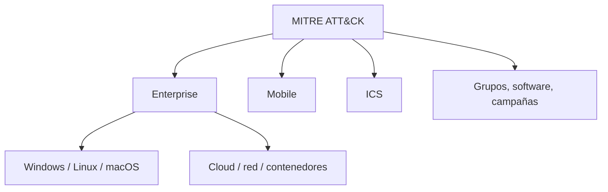
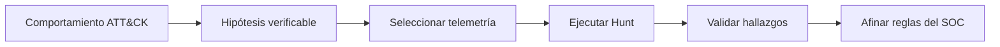

# MITRE ATT&CK — fundamentos aplicados a Threat Hunting

> Notas basadas en el módulo 04 de CyberWarFare Labs, páginas 62–66. Son apuntes de la clase y ejemplos explicativos; no son resultados de un laboratorio propio.

## Por qué es útil

MITRE ATT&CK organiza tácticas y técnicas de comportamiento adversario. Permite clasificar observaciones, formular hipótesis y detectar brechas en la cobertura del SOC. Una táctica explica el **objetivo**, una técnica explica **cómo** y un procedimiento describe **qué hizo un actor en un caso concreto**.

**Analogía:** el mapa de un edificio explica las rutas posibles, pero no demuestra por sí mismo que alguien haya pasado por una puerta.

## Organización descrita en la clase

La presentación divide ATT&CK en **Enterprise, Mobile e ICS**; en Enterprise se muestran Windows, macOS, Linux, red, servicios cloud y contenedores. Además presenta el contexto CTI de **grupos, software y campañas**.

## Relación con los casos del módulo

| Caso visto | Táctica / concepto | Pregunta de hunting |
|---|---|---|
| Tarea cron que llama a script | Persistencia; Scheduled Task/Job: Cron (T1053.003) | ¿Qué tareas invocan archivos no habituales? |
| Script con destino TCP | Posible Command and Control (TA0011) | ¿Hubo conexión saliente real desde ese proceso? |
| Ejecución privilegiada mediante sudo y find | Privilege Escalation | ¿Quién autorizó el cambio de privilegios y qué proceso lo inició? |

Estos mapeos son **orientaciones de estudio**, no confirmaciones de ataques. Hay que consultar el registro, el proceso, el usuario, la cronología y el contexto.

## Cómo usarlo para una hipótesis

Ejemplo: «Podrían existir tareas cron que ejecuten scripts en directorios de usuario y generen conexiones externas fuera de lo habitual». Se buscan tareas, scripts y tráfico; no se concluye actividad maliciosa solo por encontrar una coincidencia.

## Recordatorio

**Kill Chain** describe fases de una intrusión; **ATT&CK** describe tácticas y técnicas; **Threat Hunting** busca evidencia para comprobar hipótesis.

Consulta complementaria: https://attack.mitre.org/

**Fuente:** CyberWarFare Labs, BTF Module 04, pp. 62–66. Los identificadores específicos son contexto de estudio añadido a las diapositivas.
