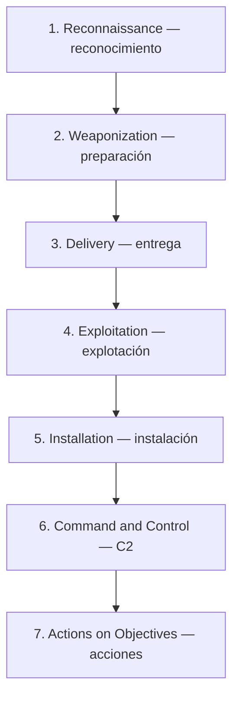
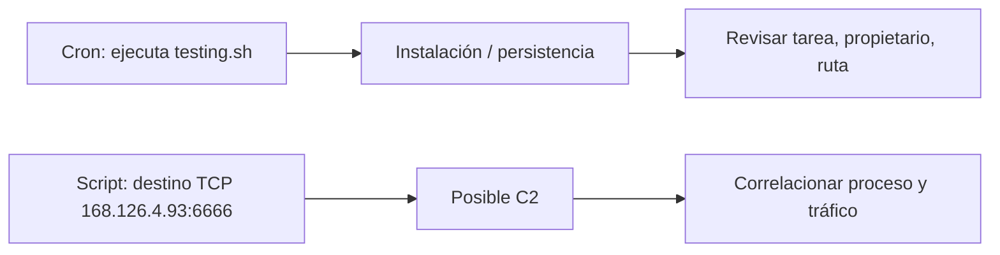

# Cyber Kill Chain — las siete fases

> Apuntes del módulo 04 de CyberWarFare Labs, páginas 67–70. El modelo es de Lockheed Martin. Las analogías y las precauciones de interpretación son notas de estudio.

## ¿Para qué sirve?

Divide un ataque en etapas para analizar dónde se podría detectar o interrumpir. No todos los incidentes reales atraviesan las siete etapas secuencialmente.

| Etapa | Explicación | Evidencia defensiva posible |
|---|---|---|
| Reconocimiento | Estudiar al objetivo | Sondeos y enumeración |
| Preparación | Construir recursos de ataque | Artefactos conocidos por inteligencia |
| Entrega | Hacer llegar contenido | Correo, web, descargas |
| Explotación | Aprovechar una debilidad | Ejecución o acceso inusual |
| Instalación | Introducir componentes | Scripts, servicios o tareas cron |
| C2 | Intentar mantener comunicación bajo control del adversario | Registros de procesos y red |
| Acciones | Ejecutar objetivos de la operación | Acceso a datos, cambios, exfiltración |

## Conexión con la práctica de Velociraptor

El vídeo sitúa la tarea programada como parte de **Installation** y la comunicación del script con el destino remoto como un ejemplo de **Command and Control**.

El hallazgo visual **no confirma una conexión exitosa**. El script demuestra una instrucción de conexión; para confirmar actividad real hacen falta eventos de host o paquetes/registros de red.

## Cómo pensar la defensa

Imagina que alguien instala un teléfono clandestino en una oficina. Encontrarlo explica una forma de comunicarse, pero no aclara cómo entró ni qué información pudo obtener. Hay que investigar otras fases sin presuponer resultados.

**No basta bloquear la IP** si permanece una tarea que relanza un script sospechoso. La respuesta debe valorar el mecanismo de persistencia y el alcance.

## Diferencia con MITRE ATT&CK

Kill Chain ofrece una secuencia general; ATT&CK aporta un vocabulario más detallado de tácticas y técnicas; el hunting busca corroboración en evidencia concreta.

## Autoevaluación

1. ¿En qué fase encaja la instalación de un mecanismo de persistencia?
2. ¿En cuál se investiga la comunicación con un controlador?
3. ¿Por qué una IP dentro del código no confirma una sesión C2?
4. ¿Por qué es insuficiente bloquear un destino externo sin analizar cron?

**Fuente:** CyberWarFare Labs, BTF Module 04, páginas 67–70 y explicación del instructor.
