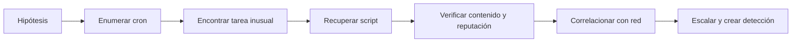

# 04 — Cyber Threat Hunting

> Apuntes personales de **Blue Team Fundamentals (CyberWarFare Labs)**. Esta sección documenta la parte conceptual y la demostración con Velociraptor para revisar tareas programadas sospechosas.

## Índice

1. [Fundamentos, hipótesis y ciclo de Threat Hunting](01-fundamentos-y-ciclo.md)
2. [Práctica guiada: Velociraptor y tareas programadas](02-velociraptor-scheduled-tasks.md)
3. [Análisis del caso, criterios de validación y repaso](03-analisis-caso-y-repaso.md)
4. [Command and Control (C2): explicación y correlación con cron](04-command-and-control-c2.md)

## La idea principal

Un hunter no espera necesariamente a que el SIEM avise. Parte de una **hipótesis** y sale a buscar evidencia con una pregunta concreta.

En la demostración: **¿hay una tarea programada que mantiene un script sospechoso activo en los hosts Linux del laboratorio?**

## Aprendizajes del ejemplo

- Diferenciar tarea de administración y posible mecanismo de persistencia.
- Usar los artefactos `Linux.Sys.Crontab` y `Linux.Search.FileFinder` de Velociraptor.
- Interpretar los resultados de un Hunt por host y flujo.
- No confundir ausencia de detección antivirus con seguridad.
- Distinguir contenido potencialmente peligroso de una ejecución o conexión **confirmada**.
- Entender la diferencia entre la **persistencia con cron** y un posible **canal Command and Control (C2)**.

El vídeo muestra la ruta `testing.sh` y un destino TCP en el contenido recuperado. No demuestra por sí solo una conexión exitosa; eso se tendría que verificar con registros de procesos y red.

**Nota:** no he ejecutado este laboratorio en mi propia infraestructura. Estas son notas de estudio basadas en el material compartido del curso, con diagramas explicativos propios.
