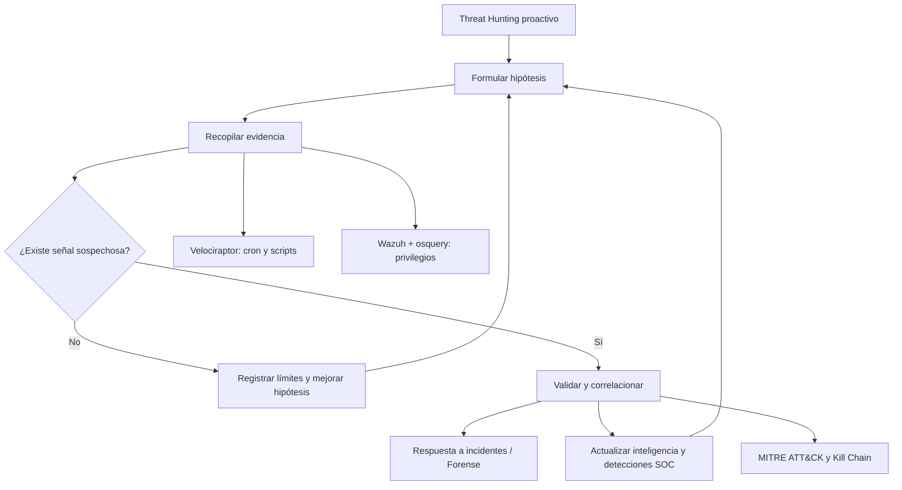

# 04 — Cyber Threat Hunting

> Mis apuntes de **Blue Team Fundamentals — CyberWarFare Labs**. Cobertura del PDF de 71 páginas, con las dos demostraciones del curso (tareas programadas y escalada de privilegios), MITRE ATT&CK y Cyber Kill Chain. Son apuntes sobre el material; no afirmo haber ejecutado esos laboratorios personalmente.

## Contenido del módulo

1. [Introducción, hipótesis, herramientas y ciclo de hunting](01-fundamentos-y-ciclo.md) — pp. 2–17
2. [Laboratorio explicado: tareas cron con Velociraptor](02-velociraptor-scheduled-tasks.md) — pp. 18–36
3. [Análisis de script, reputación, red y repaso](03-analisis-caso-y-repaso.md) — pp. 37–45
4. [C2: Command and Control, persistencia y correlación](04-command-and-control-c2.md) — pp. 19–20, 43–45, 67–70
5. [Hunting de escalada de privilegios con Wazuh y osquery](05-escalada-privilegios-wazuh-osquery.md) — pp. 46–61
6. [Fundamentos de MITRE ATT&CK](06-mitre-attack.md) — pp. 62–66
7. [Cyber Kill Chain: siete fases y relación con C2](07-cyber-kill-chain.md) — pp. 67–70

## Mapa general

## Qué me llevo de este capítulo

Threat Hunting no se limita a revisar alertas: parte de hipótesis comprobables. En el caso de **cron**, la investigación muestra por qué hay que leer el contenido y examinar conexiones en vez de confiar solamente en un resultado de VirusTotal. En **escalada de privilegios**, el contexto de sudo, UID/EUID, procesos padres y SSH es indispensable. ATT&CK y Kill Chain ayudan a organizar lo aprendido, pero no sustituyen la evidencia.

**Material base:** *BTF Module 04 — Cyber Threat Hunting*, CyberWarFare Labs, 71 páginas, y capturas/transcripciones de la explicación compartidas para estudiar.
