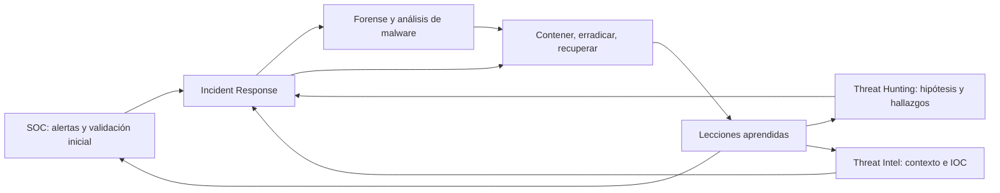
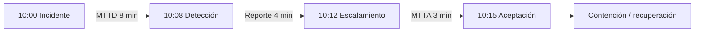

# 01 — Incident Response: qué hace el equipo y cómo medirlo

> Base: *BTF Module 05 — Incident Response Strategies and Techniques*, CWL, páginas 3–10, más las explicaciones del video. Apuntes de estudio, no una transcripción literal.

## ¿Para qué sirve IR?

**Incident Response (IR)** es el proceso organizado para identificar, analizar, contener, erradicar y recuperarse de incidentes. La diferencia entre advertir algo y responder es que IR toma decisiones con impacto operativo: aislar un host, bloquear accesos, preservar evidencias, restaurar servicios y comunicar resultados.

**Analogía de bomberos.** El SOC sería quien ve el humo y da la alarma; Threat Hunting inspecciona lugares donde podría existir fuego que nadie ha reportado; Threat Intelligence identifica métodos recurrentes y amenazas; IR llega con un plan para controlar el incendio, impedir que se propague y devolver el lugar a condiciones seguras. Malware Analysis y Forensics apoyan explicando qué ocurrió y qué evidencia conservar. Nadie trabaja completamente solo.

## Evento, alerta e incidente

| Concepto | Interpretación práctica |
|---|---|
| Evento | Algo sucedió: inicio de sesión, conexión, creación de tarea |
| Alerta | Una regla o herramienta considera que merece atención |
| True positive | La detección corresponde a una actividad realmente observada y relevante |
| False positive | El detector se activó sin que exista la amenaza que pretendía identificar |
| Incidente | Suceso que compromete o amenaza la seguridad y requiere gestión coordinada |

No toda alerta implica un ataque confirmado. **Validar antes de bloquear** evita afectar servicios legítimos.

## ¿Qué es un playbook?

Es una guía operativa para cierto escenario, no una lista inamovible de comandos. Define disparadores, responsables, información mínima, criterios de severidad, evidencia, contención, escalamiento, recuperación y condiciones de cierre.

Ejemplo: en un posible phishing, antes de borrar mensajes hay que conservar encabezados, identificar destinatarios y saber si alguien abrió el enlace o ejecutó el adjunto. Las acciones cambian según el alcance.

## Métricas de tiempos de respuesta (p. 10)

El material muestra **MTTD**, **MTTR** para *Mean Time to Report*, **MTTA** y nuevamente **MTTR** para *Mean Time to Respond*. Esa doble sigla es ambigua; en mis notas indicaré siempre el nombre completo.

| Métrica | Qué intervalo mide | Ejemplo |
|---|---|---|
| MTTD — Mean Time to Detect | Ocurrencia → detección | Actividad a las 10:00, alerta a las 10:08: 8 min |
| Mean Time to Report | Detección → reporte/escalamiento | 10:08 a 10:12: 4 min |
| MTTA — Mean Time to Acknowledge | Asignación/notificación → aceptación del caso | 10:12 a 10:15: 3 min |
| Mean Time to Respond | Punto inicial definido → respuesta efectiva | Debe especificarse si termina con inicio de contención o resolución |

**Importante:** distintos equipos emplean MTTR para *respond*, *resolve*, *recover* o *repair*. Sin definición explícita, comparar dashboards lleva a conclusiones incorrectas.

## Priorizar con criterio

Las diapositivas muestran las etiquetas **Critical, High, Medium y Low**. La prioridad real depende de la combinación de impacto, alcance, sensibilidad del activo, actividad en curso y urgencia. Un phishing no es automáticamente medio y un ransomware no siempre tiene el mismo alcance.

Preguntas antes de clasificar: ¿hay un atacante activo?, ¿qué equipos están comprometidos?, ¿existe movimiento lateral?, ¿hay evidencia de exfiltración?, ¿qué servicio de negocio está afectado?, ¿qué contención puede interrumpir el servicio?

**Para recordar:** la meta no es cerrar tickets rápido; es reducir daño con decisiones sustentadas y medibles.
