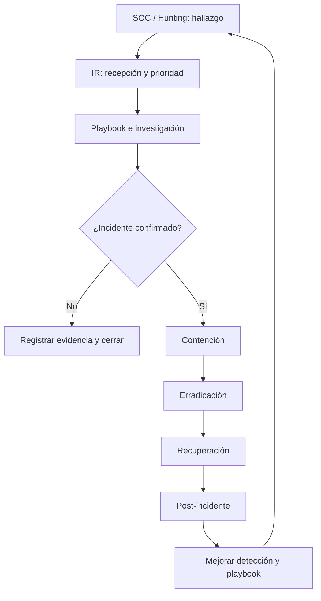
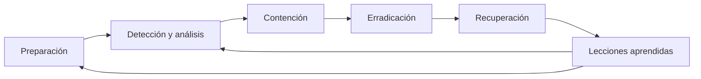

# 02 — Flujo de atención y ciclo de vida de IR

> Base: módulo 5, páginas 8, 11–13 y 17–24; complementado con las explicaciones de las capturas del video.

## Flujo que enseña el curso

Las *tres fases de trabajo* de las diapositivas no son idénticas a las fases del *ciclo de vida*. El primer esquema habla del enrutamiento del caso, el segundo de las actividades que se ejecutan a lo largo del incidente.

1. **Fase operativa 01:** SOC o Threat Hunting confirma una actividad sospechosa y la transfiere a IR para priorización.
2. **Fase operativa 02:** IR utiliza un playbook apropiado, determina la criticidad e investiga.
3. **Fase operativa 03:** valida si hay incidente. Si es verdadero, contiene, erradica y recupera. Si no, documenta y cierra de forma justificada.

## Ciclo de vida: cuatro bloques del PDF

### 1. Preparation — Preparación (p. 19)

Antes de la alerta ya deben estar definidos los contactos, escalamiento, permisos, herramientas, respaldos, responsabilidades y playbooks. También es importante saber qué servicios **no se pueden apagar sin autorización**.

**Analogía:** nadie debería buscar la manguera, las llaves del edificio y los teléfonos de emergencia cuando ya hay un incendio.

### 2. Detection & Analysis — Detección y análisis (p. 20)

SIEM, EDR y XDR ayudan a reunir señales. El analista construye una línea de tiempo, valida IOCs, procesos, usuarios, equipos y otras máquinas posiblemente afectadas. La presencia de un hash o una IP en un reporte es evidencia para investigar, no una condena automática.

### 3. Containment, Eradication & Recovery — Contención, erradicación y recuperación (pp. 21–23)

| Etapa | Pregunta | Acciones ejemplares |
|---|---|---|
| Containment | ¿Cómo detengo la propagación ahora? | Aislar equipo, segmentar red, deshabilitar cuenta comprometida |
| Eradication | ¿Cómo elimino la causa y persistencia? | Quitar malware y tareas maliciosas, cerrar vulnerabilidad, revisar más hosts |
| Recovery | ¿Cómo vuelvo a operar con seguridad? | Restaurar backup limpio, reconfigurar, cambiar credenciales, monitorear |

No deben confundirse **contener** con **eliminar**: desconectar un servidor detiene comunicaciones, pero una persistencia puede seguir allí y reaparecer cuando se restaure conectividad. Tampoco se recomienda borrar evidencia antes de obtener lo necesario para el análisis.

### 4. Post-Incident Activity — Actividad posterior (p. 24)

Se reconstruye qué pasó, se explica el impacto, se revisan errores del flujo, se actualizan reglas de monitoreo y se comprueba que las mejoras se implementen.

## Ejemplo: endpoint con persistencia por tarea programada

Un host establece conexiones repetidas hacia una dirección externa. En un ejercicio de hunting se detecta una tarea que ejecuta un script sospechoso; el caso pasa a IR.

- **Validar:** revisar creación de la tarea, usuario, comando, archivo, hash, conexiones y línea de tiempo.
- **Contener:** decidir aislamiento de host o bloqueo temporal del destino con el responsable de operaciones.
- **Preservar:** capturar evidencia útil antes de cambios destructivos cuando sea factible.
- **Erradicar:** eliminar persistencia y componentes maliciosos; evaluar credenciales y vector de entrada.
- **Recuperar:** aplicar correcciones, verificar procesos y conexiones, reincorporar bajo vigilancia.
- **Aprender:** crear detecciones para tareas anómalas y correlación con conexiones C2.

**Relación con el capítulo 4:** Threat Hunting encuentra la aguja; Incident Response determina si el hallazgo es un incidente y coordina su tratamiento. [Ver práctica de hunting de cron](../04-threat-hunting/02-velociraptor-scheduled-tasks.md).
