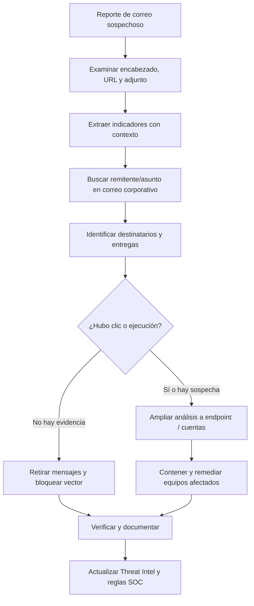
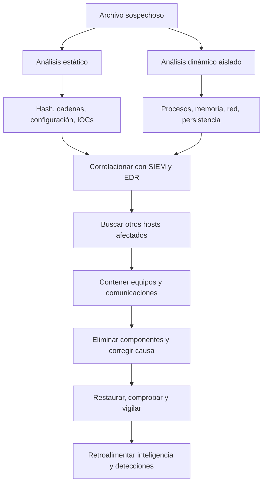

# 03 — Playbooks de phishing y malware

> Base: módulo 5, diagramas de las páginas 15 y 16, junto con las transcripciones de los dos ejemplos de respuesta. Son flujos explicados para estudio; no constituyen ejecuciones propias.

## Caso A: correo de phishing

**Situación:** SOC analiza un mensaje sospechoso y detecta una URL, una IP y un hash asociados al mensaje o adjunto. IR necesita averiguar cuántos usuarios lo recibieron y quién interactuó con él.

### Qué se investiga y por qué

| Evidencia | Qué permite responder |
|---|---|
| Encabezados completos | Origen aparente, ruta del mensaje, autenticación y posibles anomalías |
| Remitente y asunto | Buscar campañas similares en buzones |
| URL o dominio | Redirecciones, reputación y si fue visitada |
| Archivo adjunto y hash | Identidad del archivo y comportamiento, si está disponible |
| Logs de correo, proxy y EDR | Entrega, apertura, clic, descarga y ejecución (según telemetría) |
| Identidad de usuario | Credenciales afectadas, sesiones y accesos posteriores |

**Matiz importante:** recibir un correo no es lo mismo que abrirlo; abrirlo no equivale a hacer clic; y hacer clic no prueba que se ejecutó malware. En el diagrama de la clase, el camino «no accedió → erradicación» y «accedió → malware analysis» sirve como simplificación; en la práctica, ausencia de evidencia no equivale a ausencia de compromiso.

### Medidas posibles

- Retirar o poner en cuarentena mensajes equivalentes.
- Bloquear remitente, URL o dominio tras evaluar falsos positivos y el impacto.
- Si hubo interacción, investigar endpoints, sesiones de identidad y descargas.
- Si hay riesgo de robo de credenciales, revocar sesiones y remediar credenciales afectadas.
- Incorporar IOCs contextualizados y ajustar reglas para detecciones futuras.

## Caso B: malware en un endpoint

El curso divide Malware Analysis en dos frentes:

**Análisis estático:** identificación de archivo, extracción de artefactos, desensamblado o desofuscación cuando aplique y extracción de IOCs.

**Análisis dinámico:** observar comportamiento controlado, memoria y tráfico de red. Se hace en entornos aislados y autorizados, no en un computador personal sin protección.

### No quedarse en el hash

En el módulo 4 se recuperó un script mediante Velociraptor. La revisión en VirusTotal podía dar **0 detecciones** y, aun así, el contenido revelar una conexión remota sospechosa. Por eso es mejor cruzar reputación, script, tareas programadas, conexiones y otros hosts.

El hash exacto funciona como indicador de una muestra concreta, pero modificar el archivo puede cambiarlo. Una detección de comportamiento o persistencia puede tener mayor vida útil.

## Mini-playbook de decisión

| Hallazgo | Primera validación | Próximo paso |
|---|---|---|
| Hash reportado en un host | Ruta, archivo, firma, proceso que lo creó | Cotejar comportamiento y expansión |
| IP de posible C2 | Conexiones, puertos, DNS, frecuencia | Analizar el proceso que originó el tráfico |
| Tarea cron desconocida | Usuario, horario, comando y fichero | Recuperar script y revisar persistencia |
| Email con enlace sospechoso | Encabezados, destinatarios, clics | Retirar campaña y evaluar exposición |
| Host comprometido | Impacto, dependencia del negocio, evidencia | Contener con aprobación correspondiente |

## Cierre documentado

Registrar línea de tiempo, activos, fuente de detección, justificación de clasificación, IOCs e IOAs, acciones y responsables, impacto, pruebas de recuperación y nuevas reglas. Los IOCs sin contexto o las capturas de una herramienta por sí solas no cuentan toda la historia.
