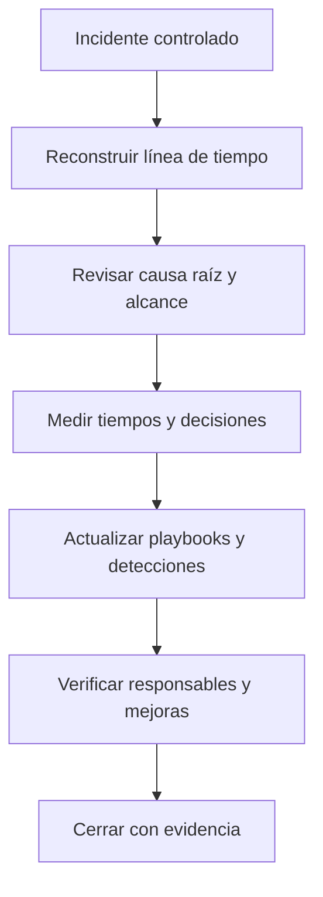

# 04 — Post-incidente, métricas y preguntas de repaso

> Base: *BTF Module 05*, páginas 18–24 y explicación de clase. Se añaden ejercicios propios para practicar lo aprendido.

## Qué entregar después de un incidente

Una respuesta técnica no termina cuando desaparece la alerta. Hay que explicar la secuencia, decidir si la causa se corrigió, medir cuánto demoró la reacción y comunicar los cambios necesarios.

## Ejemplo de registro breve (ficticio)

| Campo | Ejemplo de anotación |
|---|---|
| ID de incidente | IR-LAB-001 |
| Detección | EDR reporta tarea programada no habitual |
| Alcance inicial | Una estación de laboratorio |
| Hipótesis | Persistencia mediante script recurrente |
| Evidencia | Definición cron, ruta de script, hash y conexiones |
| Validación | Correlación de horario de tarea con conexiones |
| Contención | Aislamiento autorizado en laboratorio |
| Erradicación | Retiro de tarea y script, revisión de vector inicial |
| Recuperación | Validación funcional y monitoreo sin recurrencia |
| Mejora | Alerta para tareas nuevas con ejecutables en directorios inusuales |

**Nota:** no corresponde atribuir este caso a una investigación ejecutada en mi infraestructura: es una simulación didáctica basada en el temario.

## Errores que conviene evitar

- Marcar como seguro un archivo solo porque un antivirus no lo detectó.
- Eliminar scripts, buzones o registros antes de preservar evidencia útil.
- Bloquear indiscriminadamente una IP compartida sin evaluar impacto.
- Confundir contención con erradicación definitiva.
- Clasificar severidad solo por el nombre del ataque.
- Cerrar sin validar recuperación o sin comunicar aprendizajes.
- Comparar “MTTR” entre reportes que no usan la misma definición.

## Autoevaluación rápida

1. ¿Qué cambia entre el análisis del SOC y la respuesta de IR?

El SOC normalmente detecta y hace validación/triage; IR coordina la gestión del incidente: impacto, contención, erradicación, recuperación y cierre.

2. ¿Una alerta sobre un hash malicioso confirma infección en todos los equipos?

No. Hay que verificar presencia, ejecución, contexto y alcance por host.

3. ¿Por qué se preserva evidencia antes de borrar persistencias?

Para reconstruir lo ocurrido, entender el mecanismo y no destruir información necesaria para verificar el alcance o la causa.

4. ¿Qué harías ante un phishing entregado a 40 usuarios?

Buscar quién recibió el mensaje, quién interactuó, retirar copias, proteger cuentas afectadas, investigar hosts y registrar medidas.

5. ¿Cómo diferencias containment, eradication y recovery?

Contener frena el daño actual; erradicar elimina componentes y causa; recuperar restablece operación segura y comprueba que no haya recurrencia.

6. Si la detección fue 12 minutos después del evento y el escalamiento demoró 5, ¿cuál es MTTD?

12 minutos. Los 5 adicionales corresponden al tiempo entre detección y reporte/escalamiento según la definición usada.

## Tarea práctica para el repositorio

En un laboratorio propio, crear un escenario benigno de tarea programada, recolectar artefactos, elaborar una línea de tiempo, proponer un playbook y registrar las mejoras. No clasificar una muestra como maliciosa sin evidencia.

## Lecturas en el propio repositorio

- [Hipótesis y ciclo de Threat Hunting](../04-threat-hunting/01-fundamentos-y-ciclo.md)
- [Recolección con Velociraptor](../04-threat-hunting/02-velociraptor-scheduled-tasks.md)
- [IOC, IOA y Pyramid of Pain](../03-threat-intelligence/03-pyramid-of-pain-ioc-ioa.md)
- [Plantilla de reporte](../templates/incident-report.md)

**Fuente primaria:** CyberWarFare Labs, *Blue Team Fundamentals — Module 05: Incident Response Strategies and Techniques* (25 páginas). Capturas del video como contexto complementario. Los diagramas y ejercicios de estas notas están elaborados para estudio.
