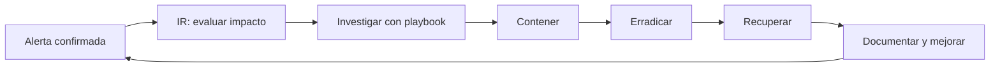

# 05 — Incident Response (respuesta a incidentes)

Apuntes de **Blue Team Fundamentals — CyberWarFare Labs**, módulo 05 (*Incident Response Strategies and Techniques*, 25 páginas), ampliados con las capturas y transcripciones de clase. El contenido está reorganizado en español, con ejemplos, analogías y diagramas Mermaid originales para repaso. No significa que estos procedimientos se hayan ejecutado en un ambiente productivo.

## Índice

1. [Fundamentos, coordinación y métricas MTTD / MTTA / MTTR](01-fundamentos-y-metricas.md) — PDF pp. 3–10
2. [Flujo de IR, priorización y ciclo de vida](02-flujo-y-ciclo-de-vida.md) — PDF pp. 8, 11–13 y 17–24
3. [Playbooks: respuesta ante phishing y malware](03-playbooks-phishing-malware.md) — PDF pp. 14–16 + demostraciones explicadas
4. [Lecciones aprendidas, errores y preguntas de repaso](04-lecciones-aprendidas-y-repaso.md) — PDF pp. 18–24

## De alerta a mejora

**Lo esencial:** responder no es solo bloquear un IOC. Hay que averiguar qué ocurrió, limitar el daño, remediar la causa, restablecer operaciones y evitar que vuelva a suceder.

**Conexión:** el [módulo 4 de Threat Hunting](../04-threat-hunting/README.md) explica cómo descubrir actividades escondidas; este módulo muestra cómo gestionarlas cuando se confirman como incidentes.
