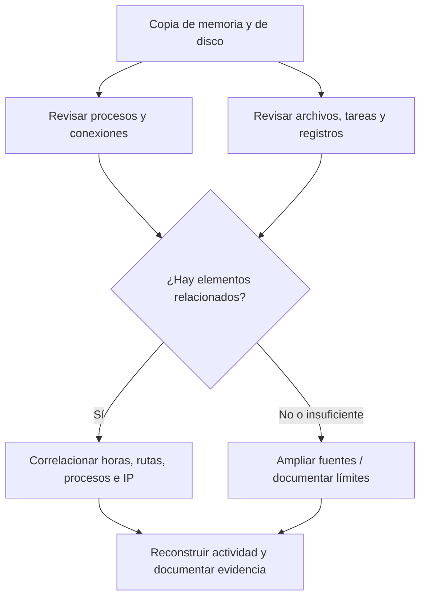

# 02 — Análisis e investigación de evidencia digital

> Apuntes BTF · Digital Forensics · Fase 02

## ¿Dónde estamos en la investigación?

En la fase anterior se recogieron evidencias del equipo comprometido (imagen de disco, memoria RAM y, si se dispone de ella, captura de tráfico). En esta fase toca **examinar esas copias**, buscar rastros y relacionarlos con lo ocurrido.

**Ojo:** la obtención debe preservar la integridad y documentar el origen de los datos; el análisis se realiza preferiblemente sobre copias de trabajo, no sobre el original.

## Herramientas de la diapositiva

| Herramienta | Uso habitual |
|---|---|
| **Volatility** | Analizar volcados de memoria: procesos, objetos del sistema y posibles conexiones. |
| **FTK Imager** | Visualizar evidencias, imágenes de disco y archivos disponibles. |
| **Autopsy** | Examinar sistemas de archivos, historiales y rastros guardados en disco. |

No todas sirven para lo mismo: un volcado de RAM y una imagen de disco muestran partes distintas de la actividad del equipo.

## ¿Qué se busca?

- **Process Information / Process Listings:** procesos activos o registrados, relaciones entre procesos y ejecuciones extrañas.
- **PE and File Extraction:** ejecutables y otros archivos que interesa recuperar y examinar.
- **Injected Code:** indicios de código introducido en memoria de otro proceso.
- **Networking Information:** conexiones, direcciones y puertos que puedan relacionarse con el incidente.
- **Logs / Histories:** eventos e historiales para reconstruir una secuencia temporal.
- **Kernel Memory and Objects:** información de objetos internos y del kernel, según el volcado disponible.
- **Registry:** configuraciones de Windows y posibles mecanismos de persistencia.
- **Password Recovery:** posible recuperación de credenciales en un contexto autorizado; no es un resultado garantizado.
- **Malware Specific:** rastros de programas sospechosos.
- **Hidden / Deleted File Retrieval:** archivos ocultos o eliminados que todavía puedan recuperarse.

## Ejemplo: equipo que se comunica con un C2

Supongamos que la respuesta a incidentes aisló un equipo que se conectaba repetidamente a una dirección externa. El trabajo forense buscaría comprobar **qué proceso inició esas conexiones**, **qué archivo lo ejecutó** y **cómo consiguió mantenerse activo**.

Si aparece un proceso inusual, un script oculto y tráfico hacia un posible C2, **todavía no basta para confirmar el ataque**. Hay que comprobar que los registros coinciden, descartar explicaciones legítimas y conservar qué evidencia respalda cada conclusión.

### Analogía rápida

Como en una investigación policial: la **Fase 01** es recoger y preservar huellas; la **Fase 02** es comparar esas huellas, estudiar los indicios y reconstruir lo que pudo pasar. Encontrar una huella no explica por sí sola toda la historia.

## Diferencia clave para recordar

| Fase 01 — Adquisición | Fase 02 — Análisis |
|---|---|
| Identificar y preservar fuentes | Examinar su contenido |
| Crear imágenes y volcados | Revisar procesos, archivos y registros |
| Registrar integridad y custodia | Correlacionar hallazgos y determinar qué respaldan |

**En una frase:** en la Fase 01 conservamos la evidencia; en la Fase 02 intentamos explicar el incidente con esa evidencia.

### Nota de clase

El material presentado enumera las herramientas y clases de artefactos que pueden investigarse, pero **no desarrolla comandos concretos ni demuestra una atribución definitiva**. Esta sección mantiene ese alcance introductorio.
